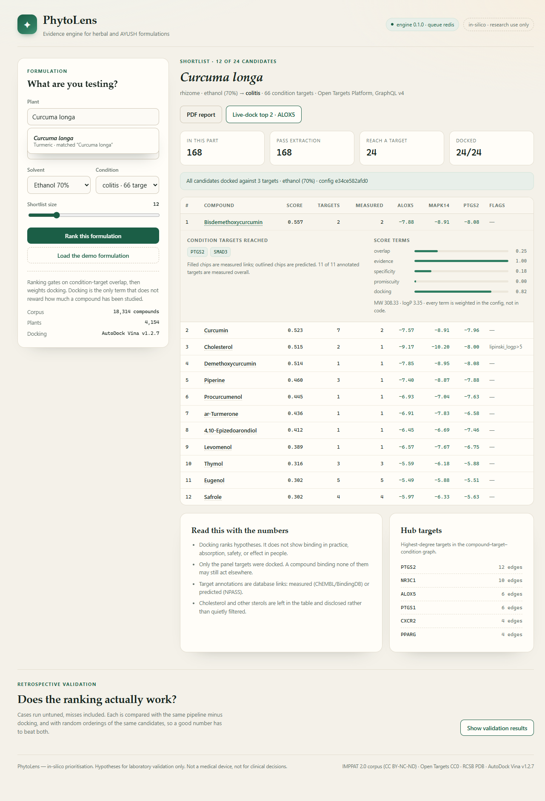
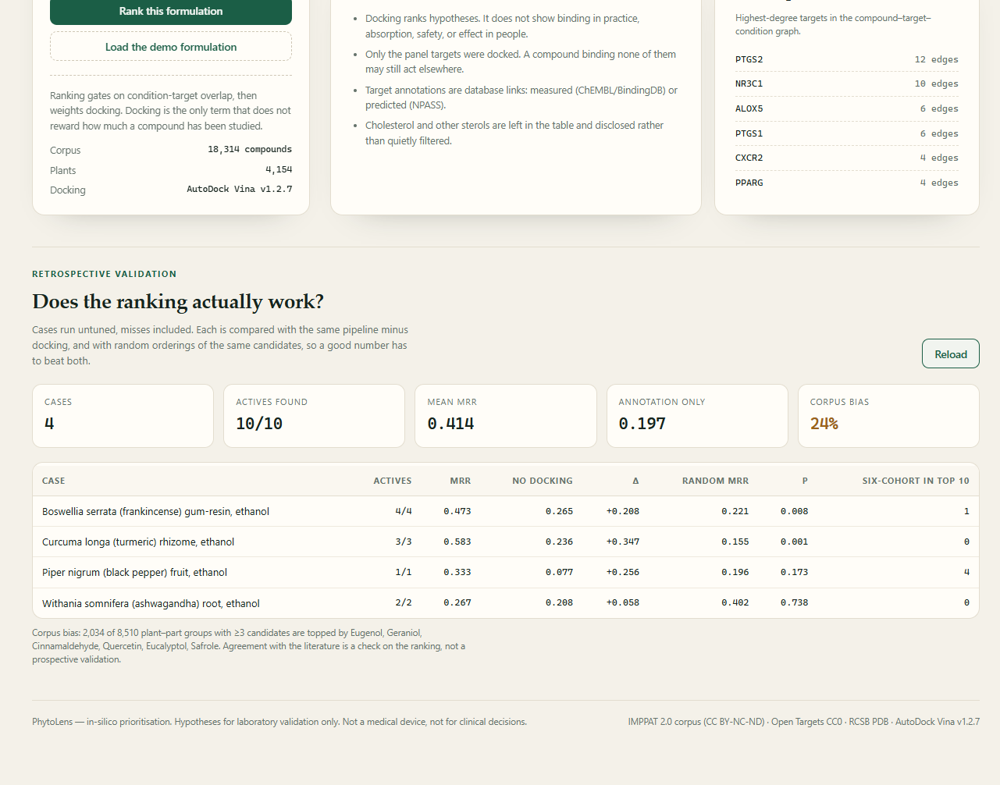
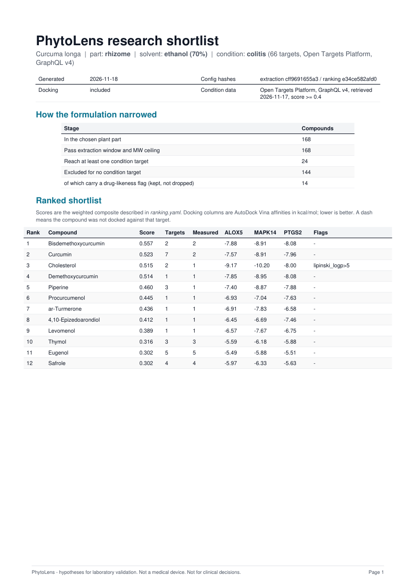

# PhytoLens

**An evidence engine for herbal and AYUSH formulations.**
Give it a plant, the plant part a preparation uses, the extraction solvent, and a
condition. Get a ranked, explainable shortlist of compounds to test first — with
docking scores and the evidence behind every link.

> **Status:** hackathon build (The Founder's Arena, PACE Mangaluru), domain
> Healthcare & Medical Solutions. This is an **in-silico research tool**.
> Outputs are hypotheses for laboratory validation, not evidence that a product
> works. Not a medical device. Not for clinical decisions or health claims.

**One line:** it tells a lab where to look first, so fewer experiments are wasted.

---

## What is actually in this repo

| Area | State |
|---|---|
| Corpus | 4,154 plants · 18,314 compounds · 195,862 plant-part links · 38,842 compound-target links (IMPPAT 2.0) |
| Extraction + drug-likeness | Config-driven; the Boswellia failure is pinned by regression tests |
| Condition target sets | Open Targets: colitis (66 targets), IBD (82) |
| Ranking | Condition overlap as a **gate**, then docking as the primary term, with evidence quality, specificity and a promiscuity penalty |
| Docking | AutoDock Vina 1.2.7 against four experimental co-crystal structures: COX-2 (3NT1), 5-LOX (3V99), p38-α (3D83), plus on-demand TNF-α (2AZ5) |
| Docking panel | 51 compounds × 3 targets — every candidate of every validation case |
| ADMET + alerts | RDKit QED, BOILED-Egg GI/BBB, PAINS (A/B/C) and Brenk structural alerts (`engine/pipeline/admet.py`) |
| API | FastAPI, 18 `/v1` endpoints, async runs, PDF reports, network graph, 3D pose & receptor PDB endpoints, live docking |
| Queue | Redis (`BRPOPLPUSH`, crash recovery), in-process fallback, standalone worker |
| Workbench | Next.js 15 app (`web/`): interactive NGL 3D receptor pocket & docked Vina pose studio, 2D RDKit structure, bipartite mechanism graph |
| Rate limits | Per-endpoint, Redis-shared, `Retry-After` + `X-RateLimit-*` |
| Auth | Optional bearer API keys (client identity for quotas/audit, not user accounts) |
| Validation | 4 cases, untuned, with ablation, permutation null and a bias-residue control |
| Tests | **109 passing** (`python -m pytest -q`) |
| CI | GitHub Actions: tests, validation run, queue smoke test, Next.js build — no Docker |

## The demo

*Curcuma longa* rhizome, 70% ethanol, condition = colitis:

```
168 compounds in the part
  → 168 pass the solvent window
  → 24 reach a colitis target
  → 24/24 docked against 3 targets
```

Ranking: **bisdemethoxycurcumin #1, curcumin #2, cholesterol #3,
demethoxycurcumin #4**; eugenol #11.

The three curcuminoids are exactly what the clinical literature identifies as
turmeric's anti-inflammatory actives — an external check, not our own intuition.
Cholesterol is a membrane sterol and is deliberately **left in and disclosed**
rather than quietly filtered.



## Retrospective validation

Defaults are untuned; every case is reported, including the ones that do not
flatter the pipeline.

| Case | Actives found | MRR | MRR without docking | Δ | Random-order MRR | p |
|---|---|---|---|---|---|---|
| *Boswellia serrata* exudate → IBD | 4 / 4 | 0.473 | 0.265 | +0.208 | 0.221 | 0.008 |
| *Curcuma longa* rhizome → colitis | 3 / 3 | 0.583 | 0.236 | +0.347 | 0.155 | 0.001 |
| *Piper nigrum* fruit → IBD | 1 / 1 | 0.333 | 0.077 | +0.256 | 0.196 | 0.173 |
| *Withania somnifera* root → IBD | 2 / 2 | 0.267 | 0.208 | +0.058 | 0.402 | 0.738 |
| **Aggregate** | **10 / 10** | **0.414** | **0.197** | **+0.217** | — | — |

Docking improves the ordering in three of four cases and hurts in none, but only
the two well-covered cases separate from chance. Piper has one active among 19
candidates and Withania two among six, where random orderings score well by
construction. Withania is included as a control and does not flatter the
pipeline — nicotine still outranks the withanolides before docking.

**What this does and does not show:** agreement with published actives supports
the usefulness of the ranking. It is not a prospective validation and does not
prove that any compound works.



The same caveats travel with every PDF the tool produces — the report carries its
own limitations page and provenance appendix, so a shortlist cannot circulate
without them:



## The corpus-bias result that motivates the product

Annotation-based ranking — counting how many targets a compound is linked to —
mostly measures how much that compound has been studied. Measured across the
corpus: **2,034 of 8,510 plant-part groups with ≥3 candidates (23.9%) are topped
by one of six ubiquitous compounds** — eugenol, geraniol, cinnamaldehyde,
quercetin, eucalyptol, safrole.

That is why target count is a gate, never a score, and why docking carries the
ranking. An earlier draft claimed 44% (1,647 / 3,710); that figure could not be
reproduced and has been withdrawn.

## How it works

```
Formulation (plant + part + solvent) + condition
        │
        ▼
Plant / plant-part → compound lookup (IMPPAT)
        │
        ▼
Extraction-aware filter (logP window, MW ceiling)
Drug-likeness (Lipinski/Veber) → FLAGS ONLY, never removes a compound
        │
        ▼
Condition target overlap → GATE (not a score)
        │
        ▼
Ranking: docking (primary) + capped overlap + evidence + specificity − promiscuity
        │
        ▼
Experimental co-crystal structures (3-target panel) → AutoDock Vina → ranked shortlist
        │
        ▼
PDF report + network graph + evidence row
```

### Methods notes

- **Extraction filter.** Whether a compound ends up in an extract depends on the
  plant part and the solvent. We approximate it with compound polarity (logP)
  against a solvent class, plus a molecular-weight ceiling. It is a heuristic,
  not an extraction model. The window is deliberately wide enough to keep the
  boswellic acids; a naive Lipinski cut would delete the most-studied active.
- **Targets.** This build does **not** run a target-prediction model. It uses
  IMPPAT's curated ChEMBL / BindingDB / NPASS compound-target links, and marks a
  link as measured if **any** listed source is non-NPASS.
- **Docking.** Vina 1.2.7, 20 Å box centred on the co-crystallised ligand,
  exhaustiveness 8, seed 42, content-addressed cache. The cache key covers
  ligand SMILES, receptor file, box, seed, exhaustiveness and Vina version, so a
  cached score is never silently reused for a different question.
- **Structures.** Experimental co-crystal structures only. ALOX5 retains its
  catalytic Fe²⁺; COX-2's peroxidase heme is ~32.5 Å from the docked
  cyclooxygenase box, and its iron survives PDBQT preparation even though Open
  Babel drops the porphyrin ring. The AlphaFold path is planned, not implemented.

## What is deliberately not built

- A bespoke target-prediction model (uses curated links instead).
- The AlphaFold / predicted-structure path.
- Full ADMET or toxicity prediction beyond the RDKit QED/BOILED-Egg/PAINS/Brenk
  annotations we expose as triage signals.
- User accounts or multi-tenancy.
- GPU docking in the served path. Uni-Dock is installed and validated in WSL2
  (see `docs/GPU_DOCKING.md`) but kept off the demo path so every number in one
  table comes from one backend.
- Prospective laboratory validation.

## Architecture

```
Next.js workbench (:3000)
        │  REST, same-origin /v1 proxy
        ▼
FastAPI (:8000) ── rate limits (Redis) ── optional bearer auth
        │
        ├── SQLite: runs, formulations, run owner
        └── Redis queue ──► engine.worker ──► ranking pipeline ──► shortlist / PDF
                                  │
                                  └── Vina (panel or live) + content-addressed cache
```

The browser calls `/v1` on its own origin; `web/next.config.ts` proxies it to
`PHYTOLENS_API_ORIGIN` (default `http://127.0.0.1:8000`). This keeps tunnelled
demos same-origin and avoids Chrome's Private Network Access block.

## Quick start

```bash
python -m pip install -r requirements.txt

# On a fresh clone, build the local corpus from IMPPAT 2.0 TSVs in engine/data/raw/imppat/
python engine/build_corpus.py

# Optional but recommended: real queue + shared rate limits
redis-server --port 6379 --save "" --appendonly no
python -m engine.worker                # second shell

uvicorn engine.api:app --host 127.0.0.1 --port 8000

cd web && npm install && npm run dev   # http://127.0.0.1:3000
```

Without Redis — or with Redis up but no worker — the API runs jobs in a thread
pool and reports `queue: "inline"`, so a demo never hangs on a missing worker.

Full docking needs the system binaries `vina` and `obabel`. The precomputed panel
loads from `engine/data/dock_scores_panel.json`; live docking also works when
both binaries are present.

### Useful commands

```bash
python -m pytest -q                              # 109 tests
python -m engine.validation --all                # untuned validation, writes results
python -m engine.pipeline.admet                  # QED, BOILED-Egg GI/BBB, PAINS + Brenk alerts
python -m engine.live_dock --plant "Zingiber officinale" --part rhizome \
  --condition colitis --targets PTGS2 --compound Gingerol --compound Shogaol
python -m engine.report --plant "Curcuma longa" --part rhizome \
  --condition colitis --dock engine/data/dock_scores_panel.json --out out.pdf
```

## API

`GET /v1/health`, `GET /v1/version`, `GET /v1/plants?q=`,
`GET /v1/plants/{id}/parts`, `GET /v1/conditions`,
`POST /v1/formulations`, `GET /v1/formulations/{id}`,
`POST /v1/runs`, `GET /v1/runs/{id}`, `GET /v1/runs/{id}/shortlist`,
`GET /v1/runs/{id}/network`, `GET /v1/runs/{id}/report.pdf`,
`POST /v1/runs/{id}/dock`, `GET /v1/validation`,
`GET /v1/structures/{target}`, `GET /v1/structures/{target}/pdb`,
`GET /v1/docking/pose/{compound_id}/{target}`, `GET /v1/demo`.

Runs are asynchronous: `POST /v1/runs` returns `202` and the client polls.
Interactive docs at `http://127.0.0.1:8000/docs`.

Live docking (`POST /v1/runs/{id}/dock`) is synchronous because it is meant to be
watched: the browser shows a running timer, and the response says how many runs
were fresh and how many were cache hits. A cold pair takes roughly 20–50 s
depending on ligand size, so the Next.js proxy timeout is raised to 180 s — at
the default 30 s the proxy abandoned the request while the engine kept docking.

## Project layout

```
engine/
├── api.py              FastAPI service (/v1)
├── auth.py             optional bearer API keys
├── jobs.py             Redis run queue + in-process fallback
├── worker.py           out-of-process run worker
├── ratelimit.py        per-endpoint limits
├── report.py           PDF shortlist
├── live_dock.py        on-demand Vina docking + re-rank
├── validation.py       cases, controls, permutation null
├── build_corpus.py     IMPPAT ingest → phytolens.db
├── fetch_targets.py    Open Targets → engine/data/targets/
├── config/             extraction.yaml, ranking.yaml
├── data/               corpus, target sets, docking panel, reports
├── pipeline/           extraction, ranking, docking
└── tests/              109 tests
web/                    Next.js 15 workbench
docs/                   status, demo plan, backend spec, GPU notes
```

## Documentation

- [`docs/PROJECT_GUIDE.md`](docs/PROJECT_GUIDE.md) — complete A-to-Z guide: what was built, how it works, results, how to run it, and Healthcare & Medical Solutions (*Diagnose, Heal, Treat*) domain fit.
- [`docs/STATUS.md`](docs/STATUS.md) — verified state, headline results, checks.
- [`docs/DEMO_RUNBOOK.md`](docs/DEMO_RUNBOOK.md) — start order, ports, tunnel steps, live-dock warm-up and fallbacks.
- [`docs/DEMO_PLAN.md`](docs/DEMO_PLAN.md) — the hackathon plan, findings and build order.
- [`docs/BACKEND_SPEC.md`](docs/BACKEND_SPEC.md) — product-grade architecture and licensing.
- [`docs/GPU_DOCKING.md`](docs/GPU_DOCKING.md) — WSL2 + Uni-Dock install and validation.

## Data and licensing

The **code** is Apache-2.0 (see `LICENSE` and `NOTICE`).

The **corpus is not**. `engine/data/phytolens.db` is built locally from IMPPAT
2.0, which is **CC BY-NC-ND 4.0** — academic/non-commercial, no derivatives.
Because of those terms, `phytolens.db` is git-ignored and excluded from git
history; build it locally with `python engine/build_corpus.py`. See
[`DATA_LICENSE.md`](DATA_LICENSE.md) for the full source table and rebuild path.

Other sources: Open Targets (CC0), RCSB PDB (public domain), AutoDock Vina
(Apache-2.0), RDKit (BSD-3), Open Babel (GPL-2.0, separate executable), Uni-Dock
(Apache-2.0, optional). Details in `DATA_LICENSE.md`.

## Limitations we state out loud

- **No prospective validation.** Agreement with known actives tests the ranking;
  it does not show a compound works.
- **Three targets in the served panel, not the proteome.** A compound binding none of them may
  act elsewhere. TNF-α (`2AZ5`) is available only as an on-demand live dock.
- **COX-2 heme is only partly retained.** The prepared PDB keeps the heme, but
  Open Babel drops the porphyrin ring when writing PDBQT and leaves the heme iron
  atoms. The heme sits ~32.5 Å from the docked cyclooxygenase box, so this does
  not affect the site we score; larger ligands may still be favoured, which is
  why ligand efficiency sits beside every affinity.
- **Cholesterol ranks #3 on the demo panel.** Real score, not a drug candidate,
  disclosed.
- **Annotation bias is reduced, not eliminated.** Geraniol still appears in the
  Boswellia top 10.
- **Small validation cases are underpowered.** p-values are reported, including
  the two that are not significant.
- **Licensing.** See above. Public sharing of this repo is for the hackathon and
  academic review context; commercial use needs a licence or a rebuilt
  plant → compound layer.
- **Not built:** accounts, multi-tenancy, full toxicity prediction beyond
  structural alerts, GPU in the served path.

## Who this is for

R&D and regulatory-affairs teams at export-oriented AYUSH or nutraceutical
brands, contract manufacturers, and pharmacy/biotech research groups. The buyer
needs mechanistic support for a formulation — R&D direction, export dossiers,
patent filings — and does not have a computational discovery team.

## Licence

Code: [Apache License 2.0](LICENSE). Data: see [DATA_LICENSE.md](DATA_LICENSE.md).
