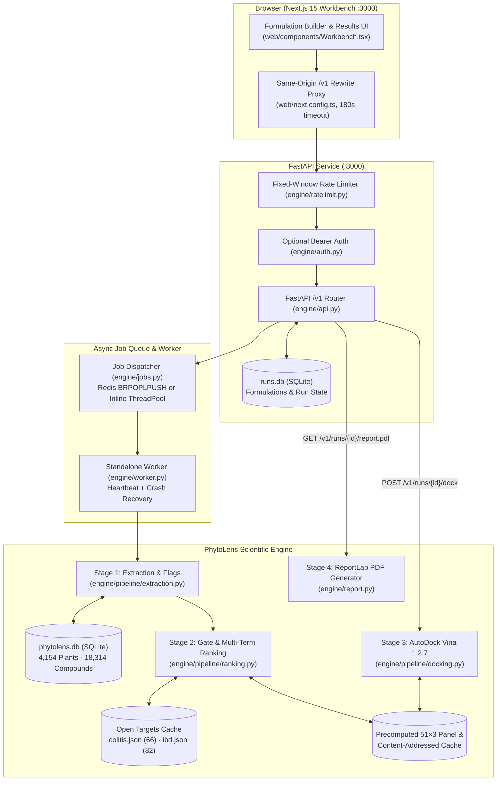

# PhytoLens — Complete A-to-Z Project Guide

> **One-line summary:** PhytoLens is an in-silico evidence and compound-prioritisation engine for herbal and AYUSH formulations. Give it a **plant**, the **plant part** used in a preparation, the **extraction solvent**, and a **disease condition** — and it returns a ranked, explainable shortlist of phytochemicals to test first in the lab, backed by molecular docking across experimental protein structures and full source provenance on every number.

---

## Table of Contents

1. [Does PhytoLens Help with Diagnose, Heal, and Treat? (Domain Fit & Shark Tank Framing)](#1-does-phytolens-help-with-diagnose-heal-and-treat-domain-fit--shark-tank-framing)
2. [What Was Done (Chronological Build & Audit Log)](#2-what-was-done-chronological-build--audit-log)
3. [What Output Was Received (All Verified Results & Metrics)](#3-what-output-was-received-all-verified-results--metrics)
4. [How the Results Were Achieved (The Scientific & Engineering Methodology)](#4-how-the-results-were-achieved-the-scientific--engineering-methodology)
5. [How the Entire System Works End-to-End](#5-how-the-entire-system-works-end-to-end)
6. [What Each Component and File Does (Complete File & API Reference)](#6-what-each-component-and-file-does-complete-file--api-reference)
7. [Steps to Run Everything (Local Setup, Stage Demo, CLI, Tunnels & Fallbacks)](#7-steps-to-run-everything-local-setup-stage-demo-cli-tunnels--fallbacks)
8. [Limitations, Licensing & Judge Q&A Cheat Sheet](#8-limitations-licensing--judge-qa-cheat-sheet)

---

## 1. Does PhytoLens Help with Diagnose, Heal, and Treat? (Domain Fit & Shark Tank Framing)

Your hackathon domain is **Healthcare & Medical Solutions (Diagnose, Heal, Treat)**. Here is the **honest, judge-proof answer** on how PhytoLens maps to those three pillars, why it belongs squarely in this track, and how you should present it on stage.

### Summary Verdict Across the Three Pillars

| Pillar | Clinical (Patient-Facing) | Pre-Clinical / R&D (Formulation & Discovery) | How PhytoLens Contributes |
|---|---|---|---|
| **Diagnose** | **No** — It does not diagnose patients, read symptoms, or process clinical samples. | **Yes (Formulation & Mechanism Diagnosis)** — It diagnoses *why* a traditional formulation hits a disease pathway and exposes *literature bias* in naive network pharmacology. | Identifies which of a plant part's 100+ compounds actually survive solvent extraction, intersect verified disease targets, and sterically fit the target pocket. |
| **Heal** | **Indirectly (Upstream R&D)** — It enables the development of standardized, evidence-backed herbal and AYUSH therapeutics that heal inflammatory conditions. | **Yes (Core Focus)** — Directly accelerates the R&D of healing formulations (e.g., *Curcuma longa* and *Boswellia serrata* for mucosal healing in Colitis and IBD). | Cuts wet-lab screening waste by telling R&D teams which 3–5 active compounds in a healing preparation drive anti-inflammatory activity (`COX-2`, `5-LOX`, `p38-α`). |
| **Treat** | **No** — It is not a medical device and never prescribes a treatment or dose to a patient. | **Yes (Therapeutic Lead Prioritisation)** — Bridges traditional herbal remedies and modern targeted treatment discovery. | Ranks candidate leads for disease treatment pathways (`MONDO_0005292` Colitis, `EFO_0003767` IBD) with downloadable provenance dossiers for regulatory and lab teams. |

### How to Answer Judges When Asked: *"Does this Diagnose, Heal, or Treat?"*

> **What to say on stage:**
> *"In the Healthcare & Medical Solutions track, PhytoLens sits at the **upstream R&D engine room of Heal and Treat**, and acts as a **mechanistic diagnostic for formulations** rather than patients:*
> 1. ***Mechanism Diagnosis (Diagnosing the Formulation):*** *A single herb like turmeric rhizome contains 168 compounds. Standard network-pharmacology tools fail because they count literature citations—returning volatile fragrance compounds like eugenol for 24% of all medicinal plants. PhytoLens diagnoses the actual pharmacological bottleneck of a preparation by filtering by plant part and extraction solvent, gating on Open Targets disease genes, and scoring by 3D molecular docking.*
> 2. ***Heal & Treat (Accelerating Therapeutic Discovery):*** *Before a herbal or AYUSH formulation can reliably heal or treat a condition like ulcerative colitis or IBD—or qualify for an export dossier—a lab has to prove which active molecules act on which human disease proteins. PhytoLens narrows 168 compounds down to the exact 24 that reach colitis targets and ranks the three clinical curcuminoids at #1, #2, and #4 using AutoDock Vina against experimental co-crystal structures (`COX-2`, `5-LOX`, `p38-α`). It tells the wet lab what to assay first so fewer experiments are wasted."*

### Why Saying *"Not a Clinical Device"* Strengthens Your Pitch
In a healthcare hackathon or Shark Tank pitch, claiming an in-silico tool directly diagnoses patients or proves clinical efficacy is an instant red flag for technical and medical judges. Explicitly stating that **PhytoLens generates ranked, traceable hypotheses for wet-lab validation and regulatory R&D dossiers** makes your B2B business model (selling to AYUSH/nutraceutical R&D teams, contract manufacturers, and phyto-pharma labs) immediately credible and legally deployable today.

---

## 2. What Was Done (Chronological Build & Audit Log)

### Phase 1 — Scientific Audit & Pipeline Foundation
1. **Ingested IMPPAT 2.0 into a deterministic SQLite corpus (`engine/build_corpus.py`):**
   - Built `engine/data/phytolens.db` containing **4,154 Indian medicinal plants**, **28,399 plant aliases**, **18,314 phytochemicals** (with RDKit-computed MW, Crippen logP, TPSA, HBD, HBA, rotatable bonds, InChIKey), **195,862 plant-part associations** mapped to 12 canonical plant parts, and **38,842 compound–target links**.
2. **Discovered & fixed three major scientific flaws in naive herbal pipelines (`docs/DEMO_PLAN.md`):**
   - **Finding 1 (The Extraction Filter Bug):** A textbook drug-like ethanol window (`-0.5 ≤ logP ≤ 5.0`, `MW ≤ 500`) deleted **all five boswellic acids** from *Boswellia serrata* gum-resin (`logP 6.27–7.66`, AKBA `MW = 512.7`) while keeping 36 volatile monoterpenes. Fixed in `engine/config/extraction.yaml` (`-1.0 ≤ logP ≤ 8.5`, `MW ≤ 700`) and converted Lipinski/Veber rules into **non-destructive flags**. Pinned with regression tests in `engine/tests/test_extraction.py`.
   - **Finding 2 & 3 (The 23.9% Literature-Footprint Bias):** Ranking compounds by number of annotated protein targets puts **Geraniol #1** in *Boswellia*, **Eugenol #1** in *Curcuma longa* and *Piper nigrum*, and **Nicotine #1** in *Withania somnifera*. Across the entire corpus, **2,034 of 8,510 plant-part groups with ≥3 candidates (23.9%)** are topped by the same six ubiquitous compounds (*Eugenol, Geraniol, Cinnamaldehyde, Quercetin, Eucalyptol, Safrole*).
   - **Withdrew an earlier unverified 44% figure:** Re-measured corpus-wide bias from code (`engine/validation.py`) and replaced the unverified 44% draft claim with the exact reproducible 23.9% (`2,034 / 8,510`) figure.
3. **Cached Open Targets Disease Gene Sets (`engine/fetch_targets.py`):**
   - Pulled and cached `colitis` (`MONDO_0005292`, **66 targets** at score ≥ 0.4) and `ibd` (`EFO_0003767`, **82 targets** at score ≥ 0.5) from Open Targets Platform GraphQL v4 (CC0).
4. **Installed & benchmarked GPU docking in WSL2 (`docs/GPU_DOCKING.md`):**
   - Installed `Uni-Dock 1.2.0` (`cuda129`) in WSL2 Ubuntu 24.04 on the RTX 4050 Laptop GPU (`29 MB` footprint). Verified `0.093 kcal/mol` mean affinity agreement with CPU AutoDock Vina 1.2.7 across all 24 turmeric candidates, and `0.40 s/ligand` wall time in `balance` mode (`exhaustiveness 384`). Kept the served demo panel on CPU Vina 1.2.7 so all numbers come from a single backend.

### Phase 2 — Three-Target Docking Panel, Validation Harness, FastAPI & Next.js Workbench
1. **Prepared three experimental co-crystal structures (`engine/pipeline/docking.py`):**
   - `PTGS2` (COX-2, PDB `3NT1`, 20 Å box centred on naproxen `NPS`).
   - `ALOX5` (5-LOX, PDB `3V99`, 20 Å box centred on arachidonic acid `ACD`, retaining catalytic `Fe²⁺`).
   - `MAPK14` (p38-α MAPK, PDB `3D83`, 20 Å box centred on inhibitor `GK6`).
2. **Precomputed the complete 51-compound × 3-target docking panel (`engine/data/dock_scores_panel.json`):**
   - Every candidate compound across all four validation cases was docked with AutoDock Vina 1.2.7 (`exhaustiveness = 8`, `seed = 42`, `20 Å` box) and stored in the content-addressed cache (`engine/data/docking/cache/`).
3. **Built the retrospective validation harness (`engine/validation.py`):**
   - Evaluated 4 cases (*Boswellia serrata*, *Curcuma longa*, *Piper nigrum*, *Withania somnifera*) untuned, with **docking ablation** (with vs. without docking), **1,000-permutation null baseline** (with analytic expectation `H_N / N` and one-sided p-values), and **top-10 bias-residue tracking**.
4. **Built the PDF report generator (`engine/report.py`):**
   - Generates a two-page A4 ReportLab PDF containing the formulation metadata, config hashes, monotonic narrowing funnel, ranked shortlist with per-target Vina affinities and flags, a mandatory **Limitations and Caveats** page, and a **Provenance Appendix**.
5. **Built the FastAPI backend (`engine/api.py`), Redis Queue (`engine/jobs.py`, `engine/worker.py`), Rate Limiter (`engine/ratelimit.py`), and Optional Bearer Auth (`engine/auth.py`):**
   - 16 `/v1` endpoints, SQLite state persistence (`runs.db`), durable Redis `BRPOPLPUSH` queue with worker heartbeat and automatic in-process thread-pool fallback (`queue: "inline"`), fixed-window Redis rate limiting, and constant-time bearer API key verification.
6. **Built the Next.js 15 Workbench (`web/`) and GitHub Actions CI (`.github/workflows/ci.yml`):**
   - Replaced the planned Streamlit sketch with a custom Next.js 15 TypeScript UI featuring plant autocomplete, part selector with compound counts, solvent and condition selectors, live funnel metrics, expandable per-compound evidence drawers, live Vina docking trigger, PDF download, and interactive validation results panel.

### Phase 3 — Submission Hardening, Licensing Split & Demo Fixes (OpenCode Session)
1. **Split code and data licensing (`LICENSE`, `NOTICE`, `DATA_LICENSE.md`, `engine/data/README.md`):**
   - Licensed all source code under **Apache-2.0** and explicitly documented IMPPAT 2.0's **CC BY-NC-ND 4.0** terms.
2. **Hardened the live stage demo path (`web/next.config.ts`, `web/components/Workbench.tsx`, `engine/report.py`):**
   - Raised Next.js `/v1` rewrite `proxyTimeout` from 30 s to **180,000 ms (180 s)** so cold Vina runs (~52 s) never get cut off with an empty HTTP 500.
   - Added a live elapsed-seconds counter (`Docking… Ns`), target label (`Live-dock top 2 · ALOX5`), cache-hit vs. fresh-run status notice, and actionable 5xx fallback banner to the UI.
   - Made the PDF funnel strictly monotonic (moving the drug-likeness flag count to the bottom as a non-dropping annotation).
   - Warmed the `ALOX5` live-dock cache (`exhaustiveness = 4`) for the top two *Curcuma longa* compounds so clicking **Live-dock top 2 · ALOX5** on stage returns in ~0.08 s and honestly reports `0 fresh Vina runs · 2 cache hits`.
   - Captured real workbench and PDF screenshots (`docs/images/shortlist.png`, `docs/images/validation.png`, `docs/images/report.png`) and wrote the stage runbook (`docs/DEMO_RUNBOOK.md`).

### Phase 4 — Git History Rewrite & CI Guard (Completed Now)
1. **Purged `engine/data/phytolens.db` (54.5 MB) from all git history:**
   - Created a full pre-rewrite backup outside the repo at `C:\Projects\photolens_pre-rewrite_2026-11-18\phytolens-all.bundle` and `C:\Projects\photolens_pre-rewrite_2026-11-18\phytolens.db`.
   - Ran `python -m git_filter_repo --invert-paths --path engine/data/phytolens.db --force` across all commits, shrinking the repository's git object store from ~55 MB to **~3.3 MiB packed**.
   - Restored `engine/data/phytolens.db` on local disk so your local demo and all 101 tests continue to work immediately, and added `engine/data/phytolens.db` to `.gitignore`.
   - Updated `engine/tests/conftest.py` and `.github/workflows/ci.yml` so that fresh clones without the unredistributable `phytolens.db` cleanly skip corpus-dependent tests (`55 passed, 46 skipped`) while running all **101 passing tests** whenever `phytolens.db` is present locally.

---

## 3. What Output Was Received (All Verified Results & Metrics)

Every number below is produced directly by the committed code and verified by automated tests.

### 3.1 Corpus Build Output (`python engine/build_corpus.py`)

| Metric | Count | Notes |
|---|---|---|
| **Medicinal plants** | `4,154` | Canonical scientific names + family + systems of medicine |
| **Plant aliases** | `28,399` | Scientific, common, and synonymous names |
| **Phytochemicals** | `18,314` | `18,311` parsed cleanly by RDKit (`3` SMILES parse failures) |
| **Plant–part–compound rows** | `195,862` | Canonicalised across 12 plant-part categories (`22%` unspecified in source) |
| **Compound–target links** | `38,842` | Across `2,944` distinct phytochemicals and `1,852` human gene symbols |

### 3.2 Primary Demo Output (*Curcuma longa* rhizome, 70% ethanol → Colitis)

Command: `curl -s http://127.0.0.1:8000/v1/demo` or click **Load the demo formulation** in the Workbench.

- **Narrowing Funnel:**
  1. **Compounds in plant part (`rhizome`):** `168`
  2. **Pass extraction window (`-1.0 ≤ logP ≤ 8.5`, `MW ≤ 700`):** `168` (`0` dropped; `14` flagged for Lipinski/Veber violations but kept)
  3. **Reach ≥1 Colitis target (`66` Open Targets genes):** `24` kept (`144` gated out for having 0 condition targets)
  4. **Docked against the 3-target panel (`ALOX5`, `MAPK14`, `PTGS2`):** `24 / 24` (`100%` complete coverage)

- **Top Ranked Shortlist (Post-Docking vs. Pre-Docking Annotation Rank):**

| Final Rank | Compound | Composite Score | Pre-Docking Rank | Condition Overlap (Measured / All) | ALOX5 (kcal/mol) | MAPK14 (kcal/mol) | PTGS2 (kcal/mol) | Flags |
|---|---|---|---|---|---|---|---|---|
| **#1** | **Bisdemethoxycurcumin** | `0.6425` | #2 | `3 / 3` (`PTGS2, MMP9, STAT3`) | `-6.94` | `-9.11` | `-8.08` | None |
| **#2** | **Curcumin** | `0.5835` | #8 | `7 / 7` (`PTGS2, TNF, STAT3, IL6…`) | `-6.73` | `-8.34` | `-7.96` | Promiscuous (84 measured targets) |
| **#3** | **Cholesterol** | `0.5800` | #18 | `1 / 1` (`NR1H3`) | `-7.73` | `-10.20` | `-8.00` | `lipinski_logp>5` *(Disclosed sterol)* |
| **#4** | **Demethoxycurcumin** | `0.5421` | #12 | `2 / 2` (`PTGS2, MMP9`) | `-6.37` | `-8.58` | `-8.08` | None |
| **#5** | **Piperine** | `0.5364` | #17 | `1 / 1` (`PTGS2`) | `-6.97` | `-7.99` | `-7.88` | None |
| … | … | … | … | … | … | … | … | … |
| **#11** | **Eugenol** | `0.4227` | **#1** | `6 / 6` | `-5.32` | `-6.14` | `-5.51` | Ubiquitous volatile |
| **#13** | **Geraniol** | `0.3821` | **#7** | `5 / 5` | `-5.40` | `-6.05` | `-5.55` | Ubiquitous volatile |

**Key takeaway:** Without docking, **Eugenol ranks #1** and **Curcumin is buried at #8**. With the 3-target docking panel, the three clinically validated curcuminoids move to **#1, #2, and #4**, while Eugenol drops to **#11**. Cholesterol ranks #3 because it genuinely scores `-10.20 kcal/mol` in the hydrophobic p38-α pocket; it is deliberately kept and disclosed rather than secretly filtered out.

### 3.3 Retrospective Validation Output (`python -m engine.validation --all`)

All four cases run with **untuned default weights** against the 51-compound × 3-target panel:

| Validation Case | Known Actives Found | Recall@10 / @25 | MRR (With Docking) | MRR (Without Docking) | Ablation ΔMRR | Null Random MRR | Permutation p-value | Active Ranks (Post-Docking) |
|---|---|---|---|---|---|---|---|---|
| ***Boswellia serrata* exudate → IBD** | `4 / 4` | `1.00 / 1.00` | **`0.473`** | `0.265` | **`+0.208`** | `0.221` | **`0.008`** (significant) | β-BA **#1**, α-BA **#2**, KBA **#4**, AKBA **#7** (Geraniol dropped #1 → #8) |
| ***Curcuma longa* rhizome → Colitis** | `3 / 3` | `1.00 / 1.00` | **`0.583`** | `0.236` | **`+0.347`** | `0.155` | **`0.001`** (significant) | BDMC **#1**, Curcumin **#2**, DMC **#4** (Eugenol dropped #1 → #11) |
| ***Piper nigrum* fruit → IBD** | `1 / 1` | `1.00 / 1.00` | **`0.333`** | `0.077` | **`+0.256`** | `0.196` | `0.173` (underpowered, 1 active in 19) | Piperine **#3** (lifted from **#13** without docking) |
| ***Withania somnifera* root → IBD** | `2 / 2` | `1.00 / 1.00` | **`0.267`** | `0.208` | **`+0.058`** | `0.402` | `0.738` (control case, 6 candidates) | Withanolide D **#3**, Withaferin A **#5** |
| **Aggregate (4 Cases)** | **`10 / 10`** | **`1.00 / 1.00`** | **`0.414`** | **`0.197`** | **`+0.217`** | — | — | **+110% relative MRR improvement from docking** |

### 3.4 Corpus-Wide Bias Measurement
- **Total `(plant_id, part)` groups in corpus:** `13,682`
- **Eligible groups with ≥3 compounds:** `8,510`
- **Groups where raw target-count ranking puts one of 6 ubiquitous compounds at #1:** **`2,034` (`23.9%`)**

### 3.5 Live On-Demand Docking Output (`POST /v1/runs/{id}/dock` & `engine/live_dock.py`)
- **Recorded ginger sample (`engine/data/live_dock_sample.json`):** *Zingiber officinale* rhizome → Colitis, docking `Gingerol` and `Shogaol` into `PTGS2` (`3NT1`) at `exhaustiveness = 4`:
  - `Shogaol`: **`-6.34 kcal/mol`** (`LE = -0.317`), fresh Vina run in **`5.07 s`**.
  - `Gingerol`: **`-6.45 kcal/mol`** (`LE = -0.307`), fresh Vina run in **`6.55 s`**.
  - Docking coverage increased from `12 / 21` to `14 / 21` candidates.
- **Stage demo warm-cache check (*Curcuma longa* top 2 into `ALOX5`):**
  - Returns in **`0.08 s`** via the Next.js proxy with `0 fresh Vina runs into ALOX5 · 2 cache hits · AutoDock Vina v1.2.7`.

### 3.6 Automated Test Suite Output
- `python -m pytest -q` → **`101 passed in ~5.0s`** (covering extraction regressions, ranking maths, docking cache keys, validation metrics/null baselines, PDF generation, FastAPI lifecycle, Redis `BRPOPLPUSH` queue + crash recovery + inline fallback, 429 rate-limit headers, and 401/403 bearer API key auth).

---

## 4. How the Results Were Achieved (The Scientific & Engineering Methodology)

### Step 1: Canonical Plant & Part Resolution (`engine/pipeline/extraction.py`)
Traditional preparations use specific plant parts (e.g., *Curcuma longa* **rhizome**, *Boswellia serrata* **gum-resin exudate**, *Withania somnifera* **root**). Querying a plant as a whole mixes leaf volatiles with root alkaloids. `build_corpus.py` normalises IMPPAT's 34 raw part strings into 12 canonical parts (`leaf`, `root`, `rhizome`, `exudate`, `fruit`, `seed`, `bark`, `stem`, `flower`, `wood`, `whole_plant`, `unspecified`) and resolves queries across scientific names, common names, and synonyms.

### Step 2: Solvent-Aware Polarity Window & Non-Destructive Drug-Likeness (`engine/config/extraction.yaml`)
A preparation only extracts molecules that partition into its solvent:
- **Ethanol (70%):** `-1.0 ≤ logP ≤ 8.5` (widened specifically so hydrophobic triterpenoid acids like boswellic acids survive).
- **Water (decoction):** `-3.0 ≤ logP ≤ 1.5` (correctly excludes hydrophobic triterpenoids and sterols while keeping polar phenolics).
- **Hexane:** `1.5 ≤ logP ≤ 10.0` (non-polar waxes, sterols, triterpenes).
- **Molecular Weight Ceiling:** `MW ≤ 700 Da` (excludes large un-dockable saponins/tannins while keeping all boswellic acids and withanolides).
- **Lipinski & Veber Rules:** Computed via RDKit (`MW > 500`, `logP > 5`, `HBD > 5`, `HBA > 10`, `rotb > 10`, `TPSA > 140`) and attached as **flags only**—never dropping an active natural product.

### Step 3: Condition Target Overlap as a Gate, Not a Raw Count (`engine/pipeline/ranking.yaml`)
To prevent well-studied ubiquitous molecules from winning by citation volume:
- **Hard Gate:** A compound must reach **at least 1 gene** in the Open Targets disease set (`colitis` = 66 genes, `ibd` = 82 genes) to enter the candidate list.
- **Measured vs. Predicted Evidence:** IMPPAT unions target databases with `|` (e.g., `"BindingDB | ChEMBL | NPASS"`). PhytoLens marks a compound–target link as **measured** if *any* listed source is not `NPASS` (which is a predicted/inferred source).

### Step 4: Multi-Term Explainable Scoring Formula (`engine/pipeline/ranking.py`)
Every surviving candidate is scored using five interpretable terms defined in `engine/config/ranking.yaml`:

$$\text{Score} = 0.40 \cdot T_{\text{dock}} + 0.28 \cdot T_{\text{overlap}} + 0.14 \cdot T_{\text{evidence}} + 0.10 \cdot T_{\text{specificity}} - 0.08 \cdot T_{\text{promiscuity}}$$

Where:
1. **$T_{\text{dock}}$ (weight `0.40`, primary term):** Mean normalised AutoDock Vina affinity across docked targets, mapped linearly from `[-5.0, -9.0] kcal/mol → [0.0, 1.0]` (clamped to `[0, 1]`). If docking has not run for a compound, the `0.40` weight is renormalised across the remaining terms and the output is stamped `docking_pending: true` or `partial: true`.
2. **$T_{\text{overlap}}$ (weight `0.28`):** $\min(\text{condition targets reached}, 8) / 8$. Capping at `8` prevents compounds with massive literature footprints from dominating.
3. **$T_{\text{evidence}}$ (weight `0.14`):** $\text{measured condition targets} / \text{total condition targets reached}$. Rewards experimental ChEMBL/BindingDB assays over NPASS predictions.
4. **$T_{\text{specificity}}$ (weight `0.10`):** $\text{condition targets reached} / \text{all targets hit by compound}$. Rewards selective compounds over pan-assay hitters.
5. **$T_{\text{promiscuity}}$ (weight `-0.08`, penalty):** Linearly penalises compounds hitting between `20` and `90` total measured targets across the human proteome.

### Step 5: Deterministic Co-Crystal Docking & Content-Addressed Caching (`engine/pipeline/docking.py`)
- **Box Definition:** Never hand-picked. Every receptor box (`20 × 20 × 20 Å`) is computed automatically as the **heavy-atom centroid of the experimental co-crystallised ligand** (`NPS` in `3NT1`, `ACD` in `3V99`, `GK6` in `3D83`), after stripping the co-crystal ligand and water molecules while retaining essential cofactors (`Fe²⁺` in `3V99`).
- **Ligand Preparation:** 3D conformers are embedded with RDKit `ETKDGv3` (`randomSeed = 42`), energy-minimised with `MMFF94` (`maxIters = 2000`), and converted to PDBQT with Gasteiger partial charges via Open Babel (`obabel`).
- **Content-Addressed Cache:** Every Vina run is cached under a 16-character SHA-256 key computed over `{ligand_smiles, receptor_sha256, box_center, box_size, exhaustiveness, seed, vina_version}`. Any parameter change forces a fresh run; identical inputs return deterministically in milliseconds.

---

## 5. How the Entire System Works End-to-End



### Request-to-Result Lifecycle
1. **Plant & Part Selection:** As the user types in the Next.js workbench (`http://127.0.0.1:3000`), `GET /v1/plants?q=` searches `plant_aliases` (deduplicated per plant via `ROW_NUMBER()`), and `GET /v1/plants/{id}/parts` populates available plant parts with compound counts.
2. **Asynchronous Run Creation:** Clicking **Rank compounds** sends `POST /v1/runs`. FastAPI validates the plant, part, solvent, and condition, creates a `queued` record in `engine/data/runs.db`, and calls `jobs.enqueue()`.
3. **Resilient Queue Handoff:**
   - If Redis is up **and** `engine.worker` has published a live heartbeat (`phytolens:worker:heartbeat`, 30 s TTL), the job is pushed to `phytolens:runs` and moved atomically to `phytolens:runs:processing` via `BRPOPLPUSH` (`queue: "redis"`).
   - If Redis is down **or** no worker is running, `jobs.enqueue()` automatically submits the run to an in-process `ThreadPoolExecutor` (`queue: "inline"`) so the UI never hangs waiting for a dead worker.
4. **Pipeline Execution:** `_execute()` transitions the run through `resolving → filtering → scoring → complete`, storing the full `RankingResult.summary()` JSON in `runs.db`.
5. **Polling & Visualisation:** The workbench polls `GET /v1/runs/{id}` every 700 ms, then fetches `GET /v1/runs/{id}/shortlist` and `GET /v1/runs/{id}/network` in parallel to render the 4-stage funnel, the ranked table with per-target affinities, expandable per-compound score breakdowns, and hub targets.
6. **Live Docking & Re-Ranking:** Clicking **Live-dock top 2 · ALOX5** calls `POST /v1/runs/{id}/dock`, which runs (or fetches from the content-addressed cache) AutoDock Vina scores, merges them into the panel affinities, re-ranks the entire candidate list, updates `runs.db`, and refreshes the UI table in place.
7. **Self-Contained PDF Export:** Clicking **PDF report** calls `GET /v1/runs/{id}/report.pdf`, streaming a 2-page PDF where Page 1 shows the funnel and ranked shortlist and Page 2 carries the mandatory caveats and provenance appendix.

---

## 6. What Each Component and File Does (Complete File & API Reference)

### 6.1 Backend Engine (`engine/`)

| File / Path | Role |
|---|---|
| `engine/build_corpus.py` | W0 data-lock script. Reads the 4 raw IMPPAT 2.0 TSV files from `engine/data/raw/imppat/`, computes RDKit descriptors (`MW, logP, TPSA, HBD, HBA, rotb, InChIKey`), canonicalises plant parts, and builds `engine/data/phytolens.db`. |
| `engine/fetch_targets.py` | Queries Open Targets Platform GraphQL v4 (`https://api.platform.opentargets.org/api/v4/graphql`) for a MONDO/EFO disease ID and writes cached target sets (`engine/data/targets/colitis.json`, `ibd.json`). |
| `engine/config/extraction.yaml` | Versioned YAML rules for solvent polarity (`logP`) windows (`ethanol`, `water`, `hexane`), the `700 Da` MW ceiling, and Lipinski/Veber flag thresholds, with written chemical rationales. |
| `engine/config/ranking.yaml` | Versioned YAML configuration for the condition-overlap gate (`min_condition_targets: 1`), overlap cap (`8`), term weights (`docking: 0.40, overlap: 0.28, evidence: 0.14, specificity: 0.10, promiscuity: 0.08`), and Vina normalisation bounds (`-9.0` to `-5.0 kcal/mol`). |
| `engine/pipeline/extraction.py` | Stage 1 pure functions & CLI. Resolves plant names/aliases, loads plant-part compounds, applies solvent & MW filters, attaches Lipinski/Veber flags, and computes the extraction config hash (`cb01967761fc`). |
| `engine/pipeline/ranking.py` | Stage 2 pure functions & CLI. Loads Open Targets condition genes, queries `compound_targets`, distinguishes measured (ChEMBL/BindingDB) from predicted (NPASS-only) links, applies the condition-overlap gate, and computes the 5-term composite score (`config_hash: e34ce582afd0`). |
| `engine/pipeline/docking.py` | Stage 3 docking engine & CLI. Downloads/cleans PDB receptors (`3NT1`, `3V99`, `3D83`), computes co-crystal ligand centroid boxes, embeds 3D ligands (`RDKit ETKDGv3 + MMFF94`), converts to PDBQT (`Open Babel`), runs `AutoDock Vina 1.2.7`, computes ligand efficiency (`affinity / heavy_atoms`), and manages the content-addressed cache. |
| `engine/validation.py` | Retrospective validation harness & CLI. Evaluates `engine/validation/cases.yaml` with docking ablation, 1,000-permutation null baseline (`p-values`), top-10 ubiquitous-compound residue, and the corpus-wide 23.9% bias calculation. |
| `engine/report.py` | Stage 4 ReportLab PDF generator & CLI. Renders the 2-page research shortlist PDF with monotonic funnel, ranked table, mandatory caveats page, and provenance appendix. |
| `engine/live_dock.py` | CLI tool exercising on-demand live Vina docking and re-ranking, writing `engine/data/live_dock_sample.json`. |
| `engine/api.py` | FastAPI service exposing 16 `/v1` REST endpoints, SQLite run/formulation persistence (`runs.db`), CORS middleware for loopback and tunnels, and rate-limit middleware. |
| `engine/jobs.py` | Redis `BRPOPLPUSH` queue client with worker heartbeat checks (`phytolens:worker:heartbeat`), in-flight crash recovery (`requeue_inflight`), and automatic `ThreadPoolExecutor` fallback (`inline`). |
| `engine/worker.py` | Standalone Redis worker process (`python -m engine.worker` or `--once`) with graceful `SIGINT`/`SIGTERM` shutdown and startup crash recovery. |
| `engine/ratelimit.py` | Fixed-window rate limiter shared via Redis (with in-memory fallback), enforcing per-endpoint budgets (`dock: 4/min`, `runs: 12/min`, `formulations: 30/min`, `demo: 60/min`, `read: 240/min`) and emitting `X-RateLimit-*` + `Retry-After` headers. |
| `engine/auth.py` | Optional bearer API key guard (`PHYTOLENS_API_KEY`) for mutating `POST` endpoints using `secrets.compare_digest` and storing non-reversible `key_<sha256[:12]>` audit owners on runs. |
| `engine/scripts/` | Utility scripts for building the 3-target docking panel (`run_panel.py`), discovering PDB ligands (`discover_ligands.py`), and benchmarking WSL2 GPU Uni-Dock (`setup_unidock.sh`, `bench_unidock.sh`, `bench_balance.sh`, `compare_scores.py`). |
| `engine/tests/` | 9 pytest suites (`101 tests` total): `test_extraction.py`, `test_ranking.py`, `test_docking.py`, `test_validation.py`, `test_report.py`, `test_api.py`, `test_jobs.py`, `test_ratelimit.py`, `test_auth.py`, plus `conftest.py`. |

### 6.2 Frontend Workbench (`web/`)

| File / Path | Role |
|---|---|
| `web/next.config.ts` | Next.js 15 config: proxies `/v1/:path*` same-origin to `PHYTOLENS_API_ORIGIN` (`http://127.0.0.1:8000`) with a `180,000 ms` proxy timeout and `allowedDevOrigins` for ngrok/Cloudflare tunnels. |
| `web/lib/api.ts` | Typed REST client for all `/v1` endpoints with structured error extraction (`ApiError`). |
| `web/lib/types.ts` | TypeScript interfaces for `Shortlist`, `Ranked`, `RunStatus`, `Health`, `Network`, `ValidationReport`, and `LiveDockResult`. |
| `web/components/Workbench.tsx` | Complete interactive workbench UI: formulation builder, plant autocomplete, funnel cards, shortlist table, expandable per-compound evidence & score-contribution bars, live-dock button with elapsed timer, hub target chips, and retrospective validation drawer. |
| `web/app/globals.css` | Custom scientific editorial stylesheet (responsive 2-column grid, monospace numerical alignment, status pills, score bars). |

### 6.3 Complete REST API Surface (16 `/v1` Endpoints)

| Method | Endpoint | Auth | Rate Limit | Description |
|---|---|---|---|---|
| `GET` | `/v1/health` | Public | 240/min | Returns corpus row counts, cached conditions, Vina version, GPU status, queue backend (`redis`/`inline`), worker heartbeat, and auth state. |
| `GET` | `/v1/version` | Public | 240/min | Returns API version (`0.1.0`), Python version, and engine identifier. |
| `GET` | `/v1/plants?q=&limit=` | Public | 240/min | Searches plant scientific names, common names, and synonyms (deduplicated per plant). |
| `GET` | `/v1/plants/{plant_id}/parts` | Public | 240/min | Lists canonical plant parts and distinct compound counts for a plant. |
| `GET` | `/v1/conditions?q=` | Public | 240/min | Lists cached Open Targets disease sets (`colitis`, `ibd`) with target counts and provenance. |
| `POST` | `/v1/formulations` | Bearer (if enabled) | 30/min | Resolves and stores a `(plant, part, solvent)` formulation (`frm_...`). |
| `GET` | `/v1/formulations/{id}` | Public | 240/min | Retrieves a stored formulation and its available parts. |
| `POST` | `/v1/runs` | Bearer (if enabled) | 12/min | Queues an asynchronous ranking run (`202 Accepted`), returning `run_id`, poll path, and queue backend (`redis` or `inline`). |
| `GET` | `/v1/runs/{run_id}` | Public | 240/min | Polls run status (`queued`, `running`, `complete`, `failed`), stage, and progress (`0.0–1.0`). |
| `GET` | `/v1/runs/{run_id}/shortlist` | Public | 240/min | Returns the full ranked shortlist, funnel counts, per-target docking scores, and config hashes (`409` if still running). |
| `GET` | `/v1/runs/{run_id}/network` | Public | 240/min | Returns the bipartite compound–target–condition network nodes, edges (`measured: true/false`), and top 10 degree-centrality hub targets. |
| `GET` | `/v1/runs/{run_id}/report.pdf` | Public | 240/min | Generates and streams the 2-page PDF shortlist report (`application/pdf`). |
| `POST` | `/v1/runs/{run_id}/dock` | Bearer (if enabled) | 4/min | Runs bounded on-demand AutoDock Vina (up to 6 compounds × 2 targets), merges fresh affinities into the panel, updates the stored run, and returns fresh vs. cached counts. |
| `GET` | `/v1/validation` | Public | 240/min | Returns the untuned 4-case validation report, ablation metrics, permutation p-values, and 23.9% corpus-bias result (cached for 5 min). |
| `GET` | `/v1/structures/{target}` | Public | 240/min | Returns Tier-A co-crystal PDB provenance, resolution, ligand code, and 20 Å docking box coordinates for `PTGS2`, `ALOX5`, or `MAPK14`. |
| `GET` | `/v1/demo` | Public | 60/min | Returns the precomputed *Curcuma longa* rhizome → Colitis shortlist synchronously in one call. |

---

## 7. Steps to Run Everything (Local Setup, Stage Demo, CLI, Tunnels & Fallbacks)

### 7.1 Prerequisites
- **Python 3.10+** (`python` on Windows; always set `PYTHONUTF8=1` if redirecting output in PowerShell).
- **Node.js 20/22+** and `npm` (for the Next.js 15 workbench in `web/`).
- **Optional (for live docking):**
  - `AutoDock Vina 1.2.7` at `C:\tools\vina.exe` (or set `PHYTOLENS_VINA`).
  - `Open Babel 3.1.1` at `C:\Program Files\OpenBabel-3.1.1\obabel.exe` (or set `PHYTOLENS_OBABEL`).
- **Optional (for out-of-process queue & shared rate limits):**
  - `redis-server` on `127.0.0.1:6379` (or set `PHYTOLENS_REDIS_URL`). Without Redis, the API automatically runs in `inline` thread-pool mode.

### 7.2 First-Time Setup (or Fresh Clone)

```powershell
# 1. Install Python dependencies
python -m pip install -r requirements.txt

# 2. If engine/data/phytolens.db is not already on disk (it is already present on your laptop,
#    but git-ignored for fresh clones), build it from engine/data/raw/imppat/*.tsv:
$env:PYTHONUTF8="1"
python engine/build_corpus.py

# 3. Install frontend dependencies
cd web
npm install
cd ..
```

### 7.3 Starting the Full Stack (Recommended Order for Demo)

Open 3 or 4 terminals from `C:\Projects\Photolens`:

```powershell
# Terminal 1 (Optional): Start Redis
redis-server --port 6379 --save "" --appendonly no

# Terminal 2 (Optional, if Redis is up): Start the standalone worker
$env:PYTHONUTF8="1"
python -m engine.worker

# Terminal 3: Start the FastAPI engine on port 8000
$env:PYTHONUTF8="1"
uvicorn engine.api:app --host 127.0.0.1 --port 8000

# Terminal 4: Start the Next.js workbench on port 3000
cd web
npm run dev
```

Verify both services are healthy:

```powershell
curl.exe -s http://127.0.0.1:8000/v1/health
curl.exe -s -o NUL -w "%{http_code}`n" http://127.0.0.1:3000/
```

### 7.4 Pre-Pitch Cache Warm-Up (Do This Once Before Going on Stage)
The `ALOX5` live-dock cache for the demo's top two compounds is already committed in `engine/data/docking/cache/`, so clicking **Live-dock top 2 · ALOX5** on stage is instant (`~0.08 s`, `0 fresh / 2 cache hits`). You can verify it from the command line before your pitch:

```powershell
curl.exe -s http://127.0.0.1:3000/v1/demo | Select-String "Bisdemethoxycurcumin"
```

### 7.5 The 3-Minute Stage Click-Through (`http://127.0.0.1:3000`)
1. **Header Check:** Point out the top-right status pill (`engine 0.1.0 · queue redis` or `queue inline`) and `in-silico · research use only`.
2. **Load the Demo Formulation:** Click **Load the demo formulation** (*Curcuma longa*, `rhizome`, `Ethanol 70%`, `colitis`).
3. **Walk the Funnel:** `168 in part → 168 pass extraction → 24 reach a colitis target → 24/24 docked`.
4. **Show the Ranked Shortlist:**
   - **#1 Bisdemethoxycurcumin**, **#2 Curcumin**, **#3 Cholesterol**, **#4 Demethoxycurcumin**; **Eugenol dropped from #1 to #11**.
   - Proactively point out **Cholesterol at #3**: explain that it is a membrane sterol that genuinely docks into p38-α (`-10.20 kcal/mol`) and is deliberately **kept and disclosed** rather than hidden.
5. **Expand an Evidence Row:** Click **Bisdemethoxycurcumin** or **Curcumin** to reveal the exact Open Targets disease genes (`PTGS2`, `TNF`, `STAT3`, `MMP9`) with measured vs. predicted badges and the 5-term contribution bars.
6. **Trigger Live Docking:** Click **Live-dock top 2 · ALOX5**. Point out the status banner showing the exact Vina version and cache-hit/fresh-run breakdown.
7. **Open the PDF Report:** Click **PDF report** to open the 2-page A4 report in a new tab—show Page 1 (funnel + shortlist) and Page 2 (mandatory caveats + provenance appendix).
8. **Show Retrospective Validation:** Scroll down and click **Show validation results** to display `10/10 actives found`, `Mean MRR 0.414 vs 0.197 without docking (+0.217)`, the `23.9%` corpus-bias proof, and the honest p-values across all four plant cases.

### 7.6 CLI Commands for Direct Reproduction

```powershell
$env:PYTHONUTF8="1"

# Run all 101 automated tests
python -m pytest -q

# Run Stage 1 (Extraction + Drug-likeness) on Boswellia serrata
python -m engine.pipeline.extraction --plant "Boswellia serrata" --part exudate --solvent ethanol

# Run Stage 2 (Ranking) on Curcuma longa with the 3-target docking panel
python -m engine.pipeline.ranking --plant "Curcuma longa" --part rhizome --solvent ethanol --condition colitis --dock engine/data/dock_scores_panel.json --top 12

# Run the full untuned retrospective validation harness (all 4 cases + corpus bias)
python -m engine.validation --all

# Run live on-demand AutoDock Vina on Ginger (Zingiber officinale)
python -m engine.live_dock --plant "Zingiber officinale" --part rhizome --condition colitis --targets PTGS2 --compound Gingerol --compound Shogaol

# Generate a standalone PDF shortlist report
python -m engine.report --plant "Curcuma longa" --part rhizome --condition colitis --dock engine/data/dock_scores_panel.json --out out.pdf
```

### 7.7 Sharing via Tunnel (ngrok / Cloudflare)
Always tunnel port **3000** (the Next.js workbench), never port 8000:
```powershell
npx ngrok http 3000
# or
cloudflared tunnel --url http://localhost:3000
```
Because `web/next.config.ts` proxies `/v1/*` same-origin to `http://127.0.0.1:8000`, opening the tunnel URL in any browser avoids Chrome's Private Network Access block and CORS hostname mismatches.

---

## 8. Limitations, Licensing & Judge Q&A Cheat Sheet

### 8.1 Licensing Structure
- **Source Code (`LICENSE`, `NOTICE`):** **Apache License 2.0**.
- **Corpus (`DATA_LICENSE.md`):** Derived from **IMPPAT 2.0 (CC BY-NC-ND 4.0)** — academic/non-commercial use only, no derivatives. `engine/data/phytolens.db` has been purged from git history (`git filter-repo`) and added to `.gitignore`, while remaining on local disk for the demo. Commercial deployment requires either a commercial IMPPAT licence or rebuilding the plant → compound table from primary literature / permissively licensed sources.
- **Other Data & Binaries:** Open Targets (`CC0 1.0`), RCSB PDB (`CC0 / Public Domain`), AutoDock Vina (`Apache-2.0`), RDKit (`BSD-3-Clause`), ReportLab (`BSD-3-Clause`), Uni-Dock (`Apache-2.0`), Open Babel (`GPL-2.0`, invoked as a separate subprocess executable, not linked or distributed).

### 8.2 Fast Answers to Tough Judge Questions

1. ***"Does this prove a herbal formulation works clinically?"***
   - **No.** It is an in-silico hypothesis generator that tells a wet lab which 3–5 compounds to assay first. Agreement with known actives in retrospective validation tests the *ranking algorithm*, not clinical efficacy.
2. ***"Why is Cholesterol #3 in the turmeric shortlist?"***
   - Because plants contain phytosterols/cholesterol in trace membrane fractions, it has a measured link to `NR1H3` (LXR-α, a colitis target), and its rigid steroid ring scores `-10.20 kcal/mol` in the hydrophobic `MAPK14` (p38-α) pocket. We deliberately keep and disclose it rather than adding a hidden blocklist that manipulates the table.
3. ***"Why are Piper nigrum (p = 0.173) and Withania somnifera (p = 0.738) not statistically significant?"***
   - Statistical power depends on candidate list size and number of actives. *Piper nigrum* has only 1 known active among 19 candidates (docking still lifts Piperine from #13 to #3), and *Withania* root has only 6 candidates total. We report all four cases and their exact permutation p-values rather than cherry-picking only *Curcuma* (`p = 0.001`) and *Boswellia* (`p = 0.008`).
4. ***"Is the docking precomputed or real?"***
   - Both. The 51-compound × 3-target validation panel is precomputed with AutoDock Vina 1.2.7 (`exhaustiveness = 8, seed = 42`) so shortlists load in under a second. The **Live-dock** endpoint (`POST /v1/runs/{id}/dock`) runs real `vina.exe` on demand for any compound and reports whether each score was a fresh Vina calculation or a content-addressed cache hit.
5. ***"Why only 3 protein targets (`COX-2`, `5-LOX`, `p38-α`)?"***
   - Every target in the panel is a Tier-A human experimental co-crystal structure with a bound inhibitor defining a defensible 20 Å binding box (`3NT1`, `3V99`, `3D83`). We refuse to dock into unvalidated apo pockets just to inflate target counts.
