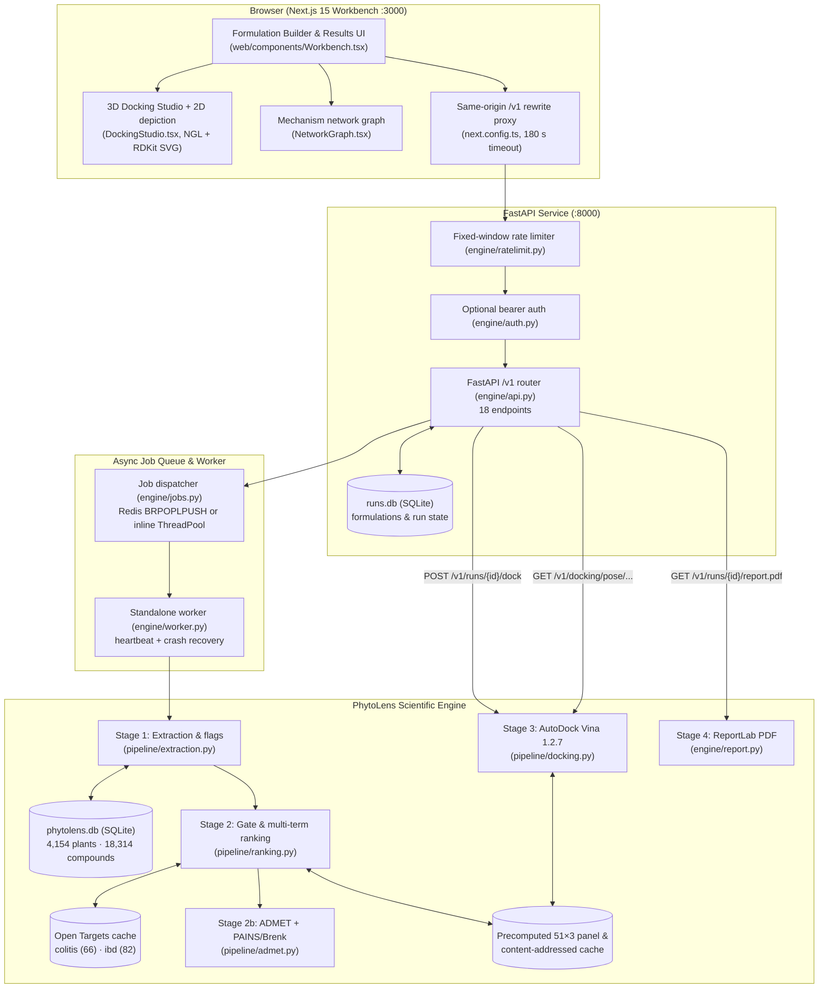

# PhytoLens — Complete A-to-Z Project Guide

> **One-line summary:** PhytoLens is an in-silico evidence and compound-prioritisation engine for herbal and AYUSH formulations. Give it a **plant**, the **plant part** used in a preparation, the **extraction solvent**, and a **disease condition** — and it returns a ranked, explainable shortlist of phytochemicals to test first in the lab, backed by molecular docking against experimental protein structures, ADMET/structural-alert annotation, and full source provenance on every number.

---

## Table of Contents

1. [Does PhytoLens Help with Diagnose, Heal, and Treat? (Domain Fit & Shark Tank Framing)](#1-does-phytolens-help-with-diagnose-heal-and-treat-domain-fit--shark-tank-framing)
2. [What Was Done (Chronological Build & Audit Log)](#2-what-was-done-chronological-build--audit-log)
3. [What Output Was Received (All Verified Results & Metrics)](#3-what-output-was-received-all-verified-results--metrics)
4. [How the Results Were Achieved (The Scientific & Engineering Methodology)](#4-how-the-results-were-achieved-the-scientific--engineering-methodology)
5. [How the Entire System Works End-to-End](#5-how-the-entire-system-works-end-to-end)
6. [What Each Component and File Does (Complete File & API Reference)](#6-what-each-component-and-file-does-complete-file--api-reference)
7. [Steps to Run Everything (Local Setup, Stage Demo, CLI, Tunnels & Fallbacks)](#7-steps-to-run-everything-local-setup-stage-demo-cli-tunnels--fallbacks)
8. [Limitations, Licensing & Judge Q&A Cheat Sheet](#8-limitations-licensing--judge-qa-cheat-sheet)

---

## 1. Does PhytoLens Help with Diagnose, Heal, and Treat? (Domain Fit & Shark Tank Framing)

Your hackathon domain is **Healthcare & Medical Solutions (Diagnose, Heal, Treat)**. The honest answer is: **PhytoLens does not diagnose, heal or treat a patient — and it should not claim to.** It is the **upstream R&D engine** that makes herbal *Heal* and *Treat* products possible, and it performs **mechanism diagnosis of a formulation**, not clinical diagnosis of a person.

That distinction is a strength, not a weakness. A judge who hears an in-silico tool claim to "diagnose patients" will immediately distrust the rest of the pitch. A judge who hears "we tell the wet lab which 3–5 molecules to assay first, with a traceable reason for every rank" understands a real B2B product.

### Summary Verdict Across the Three Pillars

| Pillar | Clinical (Patient-Facing) | Pre-Clinical / R&D (Formulation & Discovery) | How PhytoLens Contributes |
|---|---|---|---|
| **Diagnose** | **No** — It does not diagnose patients, read symptoms, or process clinical samples. | **Yes (Formulation & Mechanism Diagnosis)** — It diagnoses *why* a traditional formulation hits a disease pathway and exposes *literature bias* in naive network pharmacology. | Identifies which of a plant part's 100+ compounds actually survive solvent extraction, intersect verified disease targets, and sterically fit the target pocket. |
| **Heal** | **Indirectly (Upstream R&D)** — It enables the development of standardised, evidence-backed herbal and AYUSH therapeutics that heal inflammatory conditions. | **Yes (Core Focus)** — Directly accelerates the R&D of healing formulations (e.g., *Curcuma longa* and *Boswellia serrata* for mucosal healing in colitis and IBD). | Cuts wet-lab screening waste by telling R&D teams which 3–5 active compounds in a healing preparation drive anti-inflammatory activity across COX-2, 5-LOX and p38-α. |
| **Treat** | **No** — It is not a medical device and never prescribes a treatment or dose to a patient. | **Yes (Therapeutic Lead Prioritisation)** — Bridges traditional herbal remedies and modern targeted treatment discovery. | Ranks candidate leads for disease-treatment pathways (`MONDO_0005292` colitis, `EFO_0003767` IBD) with downloadable provenance dossiers for regulatory and lab teams. |

### How to Answer Judges When Asked: *"Does this Diagnose, Heal, or Treat?"*

> **What to say on stage:**
> *"In the Healthcare & Medical Solutions track, PhytoLens sits at the **upstream R&D engine room of Heal and Treat**, and acts as a **mechanistic diagnostic for formulations** rather than patients:*
> 1. ***Mechanism Diagnosis (diagnosing the formulation):*** *A single herb like turmeric rhizome contains 168 compounds. Standard network-pharmacology tools fail because they count literature citations — returning volatile fragrance compounds like eugenol for 24% of all medicinal plants. PhytoLens diagnoses the actual pharmacological bottleneck of a preparation by filtering by plant part and extraction solvent, gating on Open Targets disease genes, and scoring by 3D molecular docking.*
> 2. ***Heal & Treat (accelerating therapeutic discovery):*** *Before a herbal or AYUSH formulation can reliably heal or treat a condition like ulcerative colitis or IBD — or qualify for an export dossier — a lab has to prove which active molecules act on which human disease proteins. PhytoLens narrows 168 compounds down to the 24 that reach colitis targets and ranks the three clinical curcuminoids at #1, #2 and #4 using AutoDock Vina against experimental co-crystal structures (COX-2, 5-LOX, p38-α). It tells the wet lab what to assay first so fewer experiments are wasted."*

### Why Saying *"Not a Clinical Device"* Strengthens Your Pitch

In a healthcare hackathon or Shark Tank pitch, claiming an in-silico tool directly diagnoses patients or proves clinical efficacy is an instant red flag for technical and medical judges. Explicitly stating that **PhytoLens generates ranked, traceable hypotheses for wet-lab validation and regulatory R&D dossiers** makes your B2B business model — selling to AYUSH/nutraceutical R&D teams, contract manufacturers and phyto-pharma labs — immediately credible and legally deployable today.

What the tool actually outputs, and how each output maps to the domain:

| Output | What it is | Diagnose / Heal / Treat role |
|---|---|---|
| 4-stage narrowing funnel | Counts of compounds surviving part, solvent, disease-target gate and docking | **Diagnose the formulation**: where a preparation loses candidate actives |
| Ranked shortlist | Explainable composite score + per-target Vina affinities | **Heal/Treat R&D**: which molecules to assay first |
| ADMET + PAINS/Brenk annotations | QED, BOILED-Egg GI/BBB, assay-interference and structural alerts | **Developability triage**, explicitly not a safety or efficacy claim |
| 3D/2D Docking Studio | Receptor pocket, 9 Vina modes, contact distances, RDKit depiction | **Mechanistic diagnosis**: *how* a compound is predicted to bind |
| Mechanism network | Compound → target → condition graph with measured/predicted support | **Evidence audit**: which links are experimental vs. predicted |
| PDF dossier | Shortlist, caveats and provenance appendix | **Regulatory / R&D communication** |

---

## 2. What Was Done (Chronological Build & Audit Log)

### Phase 1 — Scientific Audit & Pipeline Foundation

1. **Ingested IMPPAT 2.0 into a deterministic SQLite corpus (`engine/build_corpus.py`):**
   - `engine/data/phytolens.db` contains **4,154 Indian medicinal plants**, **28,399 plant aliases**, **18,314 phytochemicals** (with RDKit-computed MW, Crippen logP, TPSA, HBD, HBA, rotatable bonds, InChIKey), **195,862 plant-part associations** mapped to 12 canonical plant parts, and **38,842 compound–target links** across **2,944** phytochemicals and **1,852** human gene symbols.
2. **Discovered and fixed three major scientific flaws in naive herbal pipelines (`docs/DEMO_PLAN.md`):**
   - **Finding 1 (the extraction-filter bug):** a textbook drug-like ethanol window (`-0.5 ≤ logP ≤ 5.0`, `MW ≤ 500`) deleted **all five boswellic acids** from *Boswellia serrata* gum-resin (`logP 6.27–7.66`, AKBA `MW = 512.7`) while keeping 36 volatile monoterpenes. Fixed in `engine/config/extraction.yaml` (`-1.0 ≤ logP ≤ 8.5`, `MW ≤ 700`) and converted Lipinski/Veber rules into **non-destructive flags**. Pinned with regression tests in `engine/tests/test_extraction.py`.
   - **Findings 2 & 3 (the 23.9% literature-footprint bias):** ranking compounds by number of annotated protein targets puts **geraniol #1** in *Boswellia*, **eugenol #1** in *Curcuma longa* and *Piper nigrum*, and **nicotine #1** in *Withania somnifera*. Across the entire corpus, **2,034 of 8,510 plant-part groups with ≥3 candidates (23.9%)** are topped by the same six ubiquitous compounds (*eugenol, geraniol, cinnamaldehyde, quercetin, eucalyptol, safrole*).
   - **Withdrew an earlier unverified 44% figure:** re-measured corpus-wide bias from code (`engine/validation.py`) and replaced the unverified draft claim with the exact reproducible 23.9% (`2,034 / 8,510`) figure.
3. **Cached Open Targets disease gene sets (`engine/fetch_targets.py`):**
   - Pulled and cached colitis (`MONDO_0005292`, **66 targets** at score ≥ 0.4) and IBD (`EFO_0003767`, **82 targets** at score ≥ 0.5) from Open Targets Platform GraphQL v4 (CC0).
4. **Installed and benchmarked GPU docking in WSL2 (`docs/GPU_DOCKING.md`):**
   - Installed `Uni-Dock 1.2.0` (`cuda129`) in WSL2 Ubuntu 24.04 on the RTX 4050 Laptop GPU (`29 MB` footprint). Verified `0.093 kcal/mol` mean affinity agreement with CPU AutoDock Vina 1.2.7 across all 24 turmeric candidates, and `0.40 s/ligand` wall time in `balance` mode (`exhaustiveness 384`). The served demo panel stays on CPU Vina 1.2.7 so every number in one table comes from one backend.

### Phase 2 — Docking Panel, Validation Harness, FastAPI & Next.js Workbench

1. **Prepared four experimental co-crystal receptor definitions (`engine/pipeline/docking.py`):**
   - `PTGS2` (COX-2, PDB `3NT1`, 20 Å box centred on naproxen `NPS`).
   - `ALOX5` (5-LOX, PDB `3V99`, 20 Å box centred on arachidonic acid `ACD`, retaining catalytic `Fe²⁺`).
   - `MAPK14` (p38-α MAPK, PDB `3D83`, 20 Å box centred on inhibitor `GK6`).
   - `TNF` (TNF-α, PDB `2AZ5`, ligand code `307`) — available for on-demand live docking; deliberately **not** in the precomputed 51-compound panel.
2. **Precomputed the complete 51-compound × 3-target docking panel (`engine/data/dock_scores_panel.json`):**
   - Every candidate compound across all four validation cases was docked with AutoDock Vina 1.2.7 (`exhaustiveness = 8`, `seed = 42`, `20 Å` box) and stored in the content-addressed cache (`engine/data/docking/cache/`).
3. **Built the retrospective validation harness (`engine/validation.py`):**
   - Evaluated 4 cases (*Boswellia serrata*, *Curcuma longa*, *Piper nigrum*, *Withania somnifera*) untuned, with **docking ablation** (with vs. without docking), a **1,000-permutation null baseline** (with analytic expectation `H_N / N` and one-sided p-values), and **top-10 bias-residue tracking**.
4. **Built the PDF report generator (`engine/report.py`):**
   - Generates a two-page A4 ReportLab PDF containing formulation metadata, config hashes, the monotonic narrowing funnel, the ranked shortlist with per-target Vina affinities and flags, a mandatory **Limitations and Caveats** page, a **Provenance Appendix**, and the data-licence footer.
5. **Built the FastAPI backend (`engine/api.py`), Redis queue (`engine/jobs.py`, `engine/worker.py`), rate limiter (`engine/ratelimit.py`) and optional bearer auth (`engine/auth.py`):**
   - **18 `/v1` endpoints** (listed in §6.3), SQLite state persistence (`runs.db`), a durable Redis `BRPOPLPUSH` queue with worker heartbeat and automatic in-process thread-pool fallback (`queue: "inline"`), fixed-window Redis rate limiting, and constant-time bearer API key verification.
6. **Built the Next.js 15 Workbench (`web/`) and GitHub Actions CI (`.github/workflows/ci.yml`):**
   - Replaced the planned Streamlit sketch with a custom Next.js 15 TypeScript UI featuring plant autocomplete, part selector with compound counts, solvent and condition selectors, live funnel metrics, expandable per-compound evidence rows, live Vina docking, PDF download, and an interactive validation panel.

### Phase 3 — Submission Hardening, Licensing Split & Demo Fixes

1. **Split code and data licensing (`LICENSE`, `NOTICE`, `DATA_LICENSE.md`, `engine/data/README.md`):**
   - Licensed all source code under **Apache-2.0** and explicitly documented IMPPAT 2.0's **CC BY-NC-ND 4.0** terms.
2. **Hardened the live stage-demo path (`web/next.config.ts`, `web/components/Workbench.tsx`):**
   - Raised the Next.js `/v1` rewrite `proxyTimeout` from 30 s to **180,000 ms (180 s)** so cold Vina runs (~52 s) never get cut off with an empty HTTP 500.
   - Added a live elapsed-seconds counter (`Docking… Ns`), target label (`Live-dock top 2 · ALOX5`), cache-hit vs. fresh-run status notice, and an actionable 5xx fallback banner.
3. **Made the PDF funnel strictly monotonic** (moving the drug-likeness flag count to the bottom as a non-dropping annotation), captured real screenshots (`docs/images/shortlist.png`, `validation.png`, `report.png`) and wrote `docs/DEMO_RUNBOOK.md`.

### Phase 4 — Git History Rewrite & CI Guard

1. **Purged `engine/data/phytolens.db` (54.5 MB) from all git history:**
   - Backed up the full pre-rewrite history and the corpus outside the repo at `C:\Projects\photolens_pre-rewrite_2026-11-18\` (`phytolens-all.bundle`, 14.5 MB; `phytolens.db`, 54.5 MB).
   - Ran `python -m git_filter_repo --invert-paths --path engine/data/phytolens.db --force` across every commit. `git log --all -- engine/data/phytolens.db` is now empty, and the packed object store is **~3.0 MiB** (it was a 14.5 MB full-history bundle before the rewrite).
   - Restored `engine/data/phytolens.db` on local disk so the local demo and all **109 tests** still run, and added it to `.gitignore`.
   - Updated `engine/tests/conftest.py` and `.github/workflows/ci.yml` so fresh clones without the unredistributable corpus cleanly skip corpus-dependent tests while running the full **109-test** suite whenever the database is present locally.

### Phase 5 — Transparency & Mechanism Features (Latest Commits)

1. **Added RDKit ADMET and structural-alert annotation (`engine/pipeline/admet.py`, commit `98375db`):**
   - QED, TPSA, Wildman–Crippen logP, BOILED-Egg GI-absorption/BBB proxies, PAINS A/B/C and Brenk alerts. These are **annotations on every ranked row**; they never delete a compound. This closed the previous "ADMET not built" gap.
2. **Added literature-support tags to compound–target links:**
   - Every condition-overlap gene now carries `support` (`measured` or `predicted`), its `sources`, and disease-association evidence (`clinical_precedence`, `europepmc`, `gwas_credible_sets` where available). The mechanism-network edges carry the same support/sources, so a judge can see which parts of a claim are experimental.
3. **Added TNF-α (`2AZ5`) as a fourth on-demand target**, plus pinned receptor-preparation tests for ALOX5 `Fe²⁺`, PTGS2 heme iron and TNF `2AZ5`.
4. **Added the 3D Molecular Docking Studio (`web/components/DockingStudio.tsx`, `f1c480c`):**
   - NGL receptor/pocket viewer, the docked Vina pose and its 9 modes, pocket-contact telemetry with residue labels/distances and cofactor flags, and an RDKit-rendered 2D structure. Backed by new endpoints `/v1/structures/{target}/pdb` and `/v1/docking/pose/{compound_id}/{target}`.
5. **Added the bipartite mechanism graph (`web/components/NetworkGraph.tsx`)** and a taller, responsive workbench layout with the Studio docked beneath the shortlist.
6. **Added the wet-lab validation protocol (`engine/validation/wetlab_protocol.md`)** and the PDF data-licence footer, and completed the remaining internal TODOs (`docs/INTERNAL_TODOS.md`).

---

## 3. What Output Was Received (All Verified Results & Metrics)

Every number below is produced directly by the committed code and verified by automated tests.

### 3.1 Corpus Build Output (`python engine/build_corpus.py`)

| Metric | Count | Notes |
|---|---|---|
| **Medicinal plants** | `4,154` | Canonical scientific names + family + systems of medicine |
| **Plant aliases** | `28,399` | Scientific, common and synonymous names |
| **Phytochemicals** | `18,314` | `18,311` parsed cleanly by RDKit (`3` SMILES parse failures) |
| **Plant–part–compound rows** | `195,862` | Canonicalised across 12 plant-part categories (`22%` unspecified in source) |
| **Compound–target links** | `38,842` | Across `2,944` distinct phytochemicals and `1,852` human gene symbols |

### 3.2 Primary Demo Output (*Curcuma longa* rhizome, 70% ethanol → colitis)

Command: `curl -s http://127.0.0.1:8000/v1/demo` or click **Load the demo formulation** in the Workbench.

- **Narrowing funnel:**
  1. **Compounds in plant part (`rhizome`):** `168`
  2. **Pass extraction window (`-1.0 ≤ logP ≤ 8.5`, `MW ≤ 700`):** `168` (`0` dropped; `14` flagged for Lipinski/Veber violations but kept)
  3. **Reach ≥1 colitis target (`66` Open Targets genes):** `24` kept (`144` gated out for having 0 condition targets)
  4. **Docked against the 3-target panel (`ALOX5`, `MAPK14`, `PTGS2`):** `24 / 24` (`100%` coverage)

- **Top ranked shortlist (post-docking vs. pre-docking annotation rank):**

| Final Rank | Compound | Composite Score | Pre-Docking Rank | Condition Overlap (Total / Measured) | ALOX5 (kcal/mol) | MAPK14 (kcal/mol) | PTGS2 (kcal/mol) | Flags |
|---|---|---|---|---|---|---|---|---|
| **#1** | **Bisdemethoxycurcumin** | `0.5572` | #2 | `2 / 2` (`PTGS2`, `SMAD3`) | `-7.881` | `-8.908` | `-8.081` | None |
| **#2** | **Curcumin** | `0.5233` | #8 | `7 / 2` | `-7.572` | `-8.910` | `-7.959` | None |
| **#3** | **Cholesterol** | `0.5148` | #18 | `2 / 1` (`NR1H3`…) | `-9.173` | `-10.195` | `-7.995` | `lipinski_logp>5` *(disclosed sterol)* |
| **#4** | **Demethoxycurcumin** | `0.5143` | #12 | `1 / 1` (`PTGS2`) | `-7.847` | `-8.953` | `-8.079` | None |
| **#5** | **Piperine** | `0.4599` | #17 | `3 / 1` | `-7.403` | `-8.872` | `-7.883` | None |
| … | … | … | … | … | … | … | … | … |
| **#11** | **Eugenol** | `0.3021` | **#1** | `5 / 5` | `-5.489` | `-5.876` | `-5.515` | Ubiquitous volatile |
| **#13** | **Geraniol** | `0.2797` | **#7** | `5 / 4` | `-5.496` | `-5.981` | `-5.552` | Ubiquitous volatile |

**Key takeaway:** without docking, **eugenol ranks #1** and **curcumin is buried at #8**. With the 3-target docking panel, the three clinically validated curcuminoids move to **#1, #2 and #4**, while eugenol drops to **#11**. Cholesterol ranks #3 because it genuinely scores `-10.195 kcal/mol` in the hydrophobic p38-α pocket; it is deliberately kept and disclosed rather than secretly filtered out.

### 3.3 Retrospective Validation Output (`python -m engine.validation --all`)

All four cases run with **untuned default weights** against the 51-compound × 3-target panel:

| Validation Case | Known Actives Found | Recall@10 / @25 | MRR (With Docking) | MRR (Without Docking) | Ablation ΔMRR | Null Random MRR | Permutation p-value | Active Ranks (Post-Docking) |
|---|---|---|---|---|---|---|---|---|
| ***Boswellia serrata* exudate → IBD** | `4 / 4` | `1.00 / 1.00` | **`0.473`** | `0.265` | **`+0.208`** | `0.221` | **`0.008`** (significant) | β-BA **#1**, α-BA **#2**, KBA **#4**, AKBA **#7** (geraniol dropped #1 → #8) |
| ***Curcuma longa* rhizome → colitis** | `3 / 3` | `1.00 / 1.00` | **`0.583`** | `0.236` | **`+0.347`** | `0.155` | **`0.001`** (significant) | BDMC **#1**, curcumin **#2**, DMC **#4** (eugenol dropped #1 → #11) |
| ***Piper nigrum* fruit → IBD** | `1 / 1` | `1.00 / 1.00` | **`0.333`** | `0.077` | **`+0.256`** | `0.196` | `0.173` (underpowered, 1 active in 19) | Piperine **#3** (lifted from **#13** without docking) |
| ***Withania somnifera* root → IBD** | `2 / 2` | `1.00 / 1.00` | **`0.267`** | `0.208` | **`+0.058`** | `0.402` | `0.738` (control case, 6 candidates) | Withanolide D **#3**, withaferin A **#5** |
| **Aggregate (4 cases)** | **`10 / 10`** | **`1.00 / 1.00`** | **`0.414`** | **`0.197`** | **`+0.217`** | — | — | **+110% relative MRR improvement from docking** |

### 3.4 Corpus-Wide Bias Measurement

- **Total `(plant_id, part)` groups in corpus:** `13,682`
- **Eligible groups with ≥3 compounds:** `8,510`
- **Groups where raw target-count ranking puts one of 6 ubiquitous compounds at #1:** **`2,034` (`23.9%`)**

### 3.5 ADMET & Structural-Alert Output (`python -m engine.pipeline.admet`)

The module annotates every ranked compound; it does not filter. Recorded output for three reference compounds:

| Compound | QED | GI absorption | BBB | PAINS | Brenk |
|---|---|---|---|---|---|
| Curcumin | `0.548` | high | no | none | `Michael_acceptor_1`, `beta-keto/anhydride` |
| Bisdemethoxycurcumin | `0.634` | high | yes | none | `Michael_acceptor_1`, `beta-keto/anhydride` |
| 3-Acetyl-11-keto-β-boswellic acid (AKBA) | `0.410` | low | no | none | none |

**Interpretation:** QED and BOILED-Egg are **developability annotations**, and PAINS/Brenk are **assay-interference / reactivity warnings**. None of them are safety, toxicity or efficacy predictions, and none remove a natural product from the table.

### 3.6 Live On-Demand Docking Output (`POST /v1/runs/{id}/dock` & `engine/live_dock.py`)

- **Recorded ginger sample (`engine/data/live_dock_sample.json`):** *Zingiber officinale* rhizome → colitis, docking gingerol and shogaol into `PTGS2` (`3NT1`) at `exhaustiveness = 4`:
  - Shogaol: **`-6.34 kcal/mol`** (`LE = -0.317`), fresh Vina run in **`5.07 s`**.
  - Gingerol: **`-6.45 kcal/mol`** (`LE = -0.307`), fresh Vina run in **`6.55 s`**.
  - Docking coverage increased from `12 / 21` to `14 / 21` candidates.
- **Stage demo warm-cache check (*Curcuma longa* top two into `ALOX5`):**
  - Returns in **`0.08 s`** through the Next.js proxy with `0 fresh Vina runs into ALOX5 · 2 cache hits · AutoDock Vina v1.2.7`.

### 3.7 Docking Studio / Pose Output (`GET /v1/docking/pose/{compound_id}/{target}`)

Verified for curcumin on ALOX5 (`3V99`):

- **9 Vina binding modes** (mode 1 affinity `-7.572 kcal/mol`, inter-molecular energy `-11.556`).
- **12 pocket contacts**, including `PHE 177` at `2.70 Å`, `GLN 557` at `2.70 Å`, `TYR 558` at `3.00 Å`, `PHE 610` at `3.03 Å`.
- **RDKit 2D SVG** returned alongside the 3D pose, plus the prepared receptor PDB from `/v1/structures/ALOX5/pdb`.
- The same payload powers the **3D Molecular Docking Studio** and the **mechanism network graph** in the workbench.

### 3.8 Automated Test Suite Output

- `python -m pytest -q` → **`109 passed`** in roughly 9 s on the development laptop.
- Coverage includes extraction regressions, RDKit ADMET/PAINS/Brenk alerts, ranking maths and literature-support tags, docking cache keys and receptor checks (`3V99 Fe²⁺`, `3NT1` heme iron, `2AZ5` TNF), validation metrics/null baselines, PDF generation with the `DATA_LICENSE.md` footer, FastAPI lifecycle, Redis `BRPOPLPUSH` queue + crash recovery + inline fallback, 429 rate-limit headers, 401/403 bearer auth, and the pose/PDB endpoints.

### 3.9 Git History Rewrite Output

| Check | Result |
|---|---|
| `git log --all -- engine/data/phytolens.db` | empty (no commit touches the corpus) |
| Pre-rewrite backup | `phytolens-all.bundle` 14.5 MB + `phytolens.db` 54.5 MB, outside the repo |
| Packed object store after rewrite | **~3.0 MiB** (`git count-objects -vH` reports `size-pack: 3.00 MiB`) |
| Local corpus | still on disk (git-ignored) so the demo and tests run |
| Remote | rewritten history pushed to `origin/main` |

---

## 4. How the Results Were Achieved (The Scientific & Engineering Methodology)

### Step 1: Canonical Plant & Part Resolution (`engine/pipeline/extraction.py`)

Traditional preparations use specific plant parts (e.g., *Curcuma longa* **rhizome**, *Boswellia serrata* **gum-resin exudate**, *Withania somnifera* **root**). Querying a plant as a whole mixes leaf volatiles with root alkaloids. `build_corpus.py` normalises IMPPAT's 34 raw part strings into 12 canonical parts (`leaf`, `root`, `rhizome`, `exudate`, `fruit`, `seed`, `bark`, `stem`, `flower`, `wood`, `whole_plant`, `unspecified`) and resolves queries across scientific names, common names and synonyms.

### Step 2: Solvent-Aware Polarity Window & Non-Destructive Drug-Likeness (`engine/config/extraction.yaml`)

A preparation only extracts molecules that partition into its solvent:

- **Ethanol (70%):** `-1.0 ≤ logP ≤ 8.5` (widened specifically so hydrophobic triterpenoid acids like boswellic acids survive).
- **Water (decoction):** `-3.0 ≤ logP ≤ 1.5` (correctly excludes hydrophobic triterpenoids and sterols while keeping polar phenolics).
- **Hexane:** `1.5 ≤ logP ≤ 10.0` (non-polar waxes, sterols, triterpenes).
- **Molecular-weight ceiling:** `MW ≤ 700 Da` (excludes large un-dockable saponins/tannins while keeping all boswellic acids and withanolides).
- **Lipinski & Veber rules:** computed via RDKit (`MW > 500`, `logP > 5`, `HBD > 5`, `HBA > 10`, `rotb > 10`, `TPSA > 140`) and attached as **flags only** — never dropping an active natural product.

### Step 3: Condition Target Overlap as a Gate, Not a Raw Count (`engine/pipeline/ranking.py`)

To prevent well-studied ubiquitous molecules from winning by citation volume:

- **Hard gate:** a compound must reach **at least 1 gene** in the Open Targets disease set (`colitis` = 66 genes, `ibd` = 82 genes) to enter the candidate list.
- **Measured vs. predicted evidence:** IMPPAT unions target databases with `|` (e.g., `"BindingDB | ChEMBL | NPASS"`). PhytoLens marks a compound–target link as **measured** if *any* listed source is not `NPASS` (which is a predicted/inferred source). Each overlap gene is returned with `support`, `sources` and disease-association evidence, so the UI can show *why* a link counts.

### Step 4: Multi-Term Explainable Scoring Formula (`engine/pipeline/ranking.py`)

Every surviving candidate is scored using five interpretable terms defined in `engine/config/ranking.yaml`:

$$\text{Score} = 0.40 \cdot T_{\text{dock}} + 0.28 \cdot T_{\text{overlap}} + 0.14 \cdot T_{\text{evidence}} + 0.10 \cdot T_{\text{specificity}} - 0.08 \cdot T_{\text{promiscuity}}$$

Where:

1. **$T_{\text{dock}}$ (weight `0.40`, primary term):** mean normalised AutoDock Vina affinity across docked targets, mapped linearly from `[-5.0, -9.0] kcal/mol → [0.0, 1.0]` (clamped to `[0, 1]`). If docking has not run for a compound, the `0.40` weight is renormalised across the remaining terms and the output is stamped `docking_pending: true` or `partial: true`.
2. **$T_{\text{overlap}}$ (weight `0.28`):** $\min(\text{condition targets reached}, 8) / 8$. Capping at `8` prevents compounds with massive literature footprints from dominating.
3. **$T_{\text{evidence}}$ (weight `0.14`):** $\text{measured condition targets} / \text{total condition targets reached}$. Rewards experimental ChEMBL/BindingDB assays over NPASS predictions.
4. **$T_{\text{specificity}}$ (weight `0.10`):** $\text{condition targets reached} / \text{all targets hit by compound}$. Rewards selective compounds over pan-assay hitters.
5. **$T_{\text{promiscuity}}$ (weight `-0.08`, penalty):** linearly penalises compounds hitting between `20` and `90` total measured targets across the human proteome.

### Step 5: Deterministic Co-Crystal Docking & Content-Addressed Caching (`engine/pipeline/docking.py`)

- **Box definition:** never hand-picked. Every receptor box (`20 × 20 × 20 Å`) is computed automatically as the **heavy-atom centroid of the experimental co-crystallised ligand** (`NPS` in `3NT1`, `ACD` in `3V99`, `GK6` in `3D83`, `307` in `2AZ5`), after stripping the co-crystal ligand and water molecules while retaining essential cofactors (`Fe²⁺` in `3V99`; heme iron in `3NT1`).
- **Ligand preparation:** 3D conformers are embedded with RDKit `ETKDGv3` (`randomSeed = 42`), energy-minimised with `MMFF94` (`maxIters = 2000`), and converted to PDBQT with Gasteiger partial charges via Open Babel (`obabel`).
- **Content-addressed cache:** every Vina run is cached under a 16-character SHA-256 key computed over `{ligand_smiles, receptor_sha256, box_center, box_size, exhaustiveness, seed, vina_version}`. Any parameter change forces a fresh run; identical inputs return deterministically in milliseconds.
- **Cofactor honesty:** the prepared `3NT1_clean.pdb` retains the 86-atom peroxidase heme, but Open Babel's PDBQT conversion keeps only the heme **iron atoms** (as `ATOM … Fe`) and drops the porphyrin ring. The heme sits ~32.5 Å from the cyclooxygenase `NPS` box, so the docked site is unaffected; the receptor test pins both the iron's presence and that distance. ALOX5's catalytic `Fe²⁺` is retained and a test verifies that docked poses approach it.

### Step 6: Non-Destructive ADMET & Alert Annotation (`engine/pipeline/admet.py`)

After ranking, each compound receives:

- **QED** (RDKit quantitative estimate of drug-likeness), TPSA and Wildman–Crippen logP.
- **BOILED-Egg proxies:** high/low gastrointestinal absorption and a blood–brain-barrier permeability flag.
- **PAINS A/B/C** assay-interference matches and **Brenk** structural/reactivity alerts.

The module is intentionally a **read-only annotation layer**: no compound is removed, no score is silently rewritten, and the UI labels these as developability/assay-interference information rather than safety claims.

### Step 7: Evidence Surfaces — Pose, Contacts and Mechanism Graph

- **Pose resolution:** for a ranked compound and target, the engine finds the matching cache entry, parses all Vina modes, computes residue contacts against the clean receptor (distance + cofactor flag), and renders a 2D RDKit SVG.
- **3D viewer:** the prepared receptor PDB is served to NGL in the browser; the pose is overlaid in the same coordinate frame.
- **Mechanism graph:** compounds, their condition-overlap targets, and the condition node are returned as a bipartite graph. Edges carry `support` and `sources`, so predicted links are visually distinguishable from measured ones.

---

## 5. How the Entire System Works End-to-End



### Request-to-Result Lifecycle

1. **Plant & part selection:** as the user types, `GET /v1/plants?q=` searches `plant_aliases` (deduplicated per plant via `ROW_NUMBER()`), and `GET /v1/plants/{id}/parts` populates available parts with compound counts.
2. **Asynchronous run creation:** clicking **Rank compounds** sends `POST /v1/runs`. FastAPI validates plant, part, solvent and condition, creates a `queued` record in `engine/data/runs.db`, and calls `jobs.enqueue()`.
3. **Resilient queue handoff:**
   - If Redis is up **and** `engine.worker` has published a live heartbeat (`phytolens:worker:heartbeat`, 30 s TTL), the job is pushed to `phytolens:runs` and moved atomically to `phytolens:runs:processing` via `BRPOPLPUSH` (`queue: "redis"`).
   - If Redis is down **or** no worker is running, `jobs.enqueue()` automatically submits the run to an in-process `ThreadPoolExecutor` (`queue: "inline"`) so the UI never hangs waiting for a dead worker.
4. **Pipeline execution:** `_execute()` transitions the run through `resolving → filtering → scoring → complete`, storing the full `RankingResult.summary()` JSON in `runs.db`. ADMET/alerts, support tags and docking scores travel in that same payload.
5. **Polling & visualisation:** the workbench polls `GET /v1/runs/{id}` every 700 ms, then fetches `GET /v1/runs/{id}/shortlist` and `GET /v1/runs/{id}/network` in parallel to render the 4-stage funnel, the ranked table with per-target affinities, expandable score breakdowns, the mechanism graph and hub targets.
6. **Live docking & re-ranking:** clicking **Live-dock top 2 · ALOX5** calls `POST /v1/runs/{id}/dock`, which runs (or fetches from the content-addressed cache) Vina scores, merges them into the panel affinities, re-ranks the candidate list, updates `runs.db` and refreshes the UI.
7. **Docking Studio:** selecting a compound loads `GET /v1/docking/pose/{compound_id}/{target}` (9 modes, contacts, 2D SVG) and `GET /v1/structures/{target}/pdb` (clean receptor), rendered with NGL and RDKit.
8. **Self-contained PDF export:** `GET /v1/runs/{id}/report.pdf` streams a 2-page PDF where page 1 shows the funnel and shortlist and page 2 carries the mandatory caveats, provenance appendix and data-licence footer.

---

## 6. What Each Component and File Does (Complete File & API Reference)

### 6.1 Backend Engine (`engine/`)

| File / Path | Role |
|---|---|
| `engine/build_corpus.py` | W0 data-lock script. Reads the 4 raw IMPPAT 2.0 TSV files from `engine/data/raw/imppat/`, computes RDKit descriptors (`MW, logP, TPSA, HBD, HBA, rotb, InChIKey`), canonicalises plant parts, and builds `engine/data/phytolens.db`. |
| `engine/fetch_targets.py` | Queries Open Targets Platform GraphQL v4 for a MONDO/EFO disease ID and writes cached target sets (`engine/data/targets/colitis.json`, `ibd.json`). |
| `engine/config/extraction.yaml` | Versioned YAML rules for solvent polarity (`logP`) windows (`ethanol`, `water`, `hexane`), the `700 Da` MW ceiling, and Lipinski/Veber flag thresholds, with written chemical rationales. |
| `engine/config/ranking.yaml` | Versioned YAML for the condition-overlap gate (`min_condition_targets: 1`), overlap cap (`8`), term weights (`docking: 0.40, overlap: 0.28, evidence: 0.14, specificity: 0.10, promiscuity: 0.08`) and Vina normalisation bounds (`-9.0` to `-5.0 kcal/mol`). |
| `engine/pipeline/extraction.py` | Stage 1 pure functions & CLI. Resolves plant names/aliases, loads plant-part compounds, applies solvent/MW filters, attaches Lipinski/Veber flags, and computes the extraction config hash (`cb01967761fc`). |
| `engine/pipeline/ranking.py` | Stage 2 pure functions & CLI. Loads Open Targets condition genes, queries `compound_targets`, distinguishes measured (ChEMBL/BindingDB) from predicted (NPASS-only) links, attaches support/sources, applies the overlap gate and computes the 5-term composite score (`config_hash: e34ce582afd0`). |
| `engine/pipeline/admet.py` | Stage 2b annotation & CLI. Computes QED, TPSA, WLogP, BOILED-Egg GI/BBB proxies, PAINS A/B/C and Brenk alerts. Never filters. |
| `engine/pipeline/docking.py` | Stage 3 docking engine & CLI. Defines four targets (`3NT1`, `3V99`, `3D83`, `2AZ5`), prepares receptors, computes co-crystal centroid boxes, embeds 3D ligands (`ETKDGv3 + MMFF94`), converts to PDBQT (Open Babel), runs AutoDock Vina 1.2.7, computes ligand efficiency, manages the cache, and resolves 9-mode poses, pocket contacts and 2D SVG. |
| `engine/validation.py` | Retrospective validation harness & CLI. Evaluates `engine/validation/cases.yaml` with docking ablation, 1,000-permutation null baseline, top-10 ubiquitous-compound residue, and the corpus-wide 23.9% bias calculation. |
| `engine/report.py` | Stage 4 ReportLab PDF generator & CLI. Renders the 2-page research shortlist PDF with monotonic funnel, ranked table, mandatory caveats page, provenance appendix and data-licence footer. |
| `engine/live_dock.py` | CLI tool exercising on-demand live Vina docking and re-ranking, writing `engine/data/live_dock_sample.json`. |
| `engine/api.py` | FastAPI service exposing **18 `/v1` REST endpoints**, SQLite run/formulation persistence (`runs.db`), CORS middleware for loopback/tunnels, and rate-limit middleware. |
| `engine/jobs.py` | Redis `BRPOPLPUSH` queue client with worker heartbeat checks, in-flight crash recovery (`requeue_inflight`), and automatic `ThreadPoolExecutor` fallback (`inline`). |
| `engine/worker.py` | Standalone Redis worker (`python -m engine.worker` or `--once`) with graceful `SIGINT`/`SIGTERM` shutdown and startup crash recovery. |
| `engine/ratelimit.py` | Fixed-window rate limiter shared via Redis (with in-memory fallback), enforcing per-endpoint budgets (`dock: 4/min`, `runs: 12/min`, `formulations: 30/min`, `demo: 60/min`, `read: 240/min`) and emitting `X-RateLimit-*` + `Retry-After` headers. |
| `engine/auth.py` | Optional bearer API key guard (`PHYTOLENS_API_KEY`) for mutating `POST` endpoints using `secrets.compare_digest` and storing non-reversible `key_<sha256[:12]>` audit owners on runs. |
| `engine/scripts/` | Utility scripts for building the docking panel (`run_panel.py`), discovering PDB ligands (`discover_ligands.py`), and benchmarking WSL2 GPU Uni-Dock (`setup_unidock.sh`, `bench_unidock.sh`, `bench_balance.sh`, `compare_scores.py`). |
| `engine/tests/` | **10 pytest suites, 109 tests**: `test_extraction.py`, `test_ranking.py`, `test_admet.py`, `test_docking.py`, `test_validation.py`, `test_report.py`, `test_api.py`, `test_jobs.py`, `test_ratelimit.py`, `test_auth.py`, plus `conftest.py`. |

### 6.2 Frontend Workbench (`web/`)

| File / Path | Role |
|---|---|
| `web/next.config.ts` | Next.js 15 config: proxies `/v1/:path*` same-origin to `PHYTOLENS_API_ORIGIN` (`http://127.0.0.1:8000`) with a `180,000 ms` proxy timeout and `allowedDevOrigins` for ngrok/Cloudflare tunnels. |
| `web/lib/api.ts` | Typed REST client for all `/v1` endpoints with structured error extraction (`ApiError`). |
| `web/lib/types.ts` | TypeScript interfaces for `Shortlist`, `Ranked`, `Admet`, `RunStatus`, `Health`, `Network`, `DockingPose`/`DockingMode`/`PocketContact`, `ValidationReport` and `LiveDockResult`. |
| `web/components/Workbench.tsx` | Main interactive UI: formulation builder, plant autocomplete, funnel cards, shortlist table, expandable per-compound evidence & score-contribution bars, live-dock button with elapsed timer, hub targets, validation panel, and wiring for the Studio and graph. |
| `web/components/DockingStudio.tsx` | Interactive 3D/2D docking studio: target switch, NGL receptor + docked-pose viewer, mode selector, pocket-contact list with distances/cofactor flags, and RDKit 2D depiction. |
| `web/components/NetworkGraph.tsx` | Bipartite compound–target–condition graph with measured/predicted edge styling and target selection. |
| `web/app/globals.css` | Custom scientific editorial stylesheet: responsive two-column grid, monospace numerical alignment, status pills, score bars, studio/network layouts. |

### 6.3 Complete REST API Surface (18 `/v1` Endpoints)

| Method | Endpoint | Auth | Rate Limit | Description |
|---|---|---|---|---|
| `GET` | `/v1/health` | Public | 240/min | Corpus row counts, cached conditions, Vina version, GPU status, queue backend (`redis`/`inline`), worker heartbeat, auth state. |
| `GET` | `/v1/version` | Public | 240/min | API version (`0.1.0`), Python version and engine identifier. |
| `GET` | `/v1/plants?q=&limit=` | Public | 240/min | Searches scientific names, common names and synonyms (deduplicated per plant). |
| `GET` | `/v1/plants/{plant_id}/parts` | Public | 240/min | Lists canonical plant parts and distinct compound counts for a plant. |
| `GET` | `/v1/conditions?q=` | Public | 240/min | Lists cached Open Targets disease sets (`colitis`, `ibd`) with target counts and provenance. |
| `POST` | `/v1/formulations` | Bearer (if enabled) | 30/min | Resolves and stores a `(plant, part, solvent)` formulation (`frm_...`). |
| `GET` | `/v1/formulations/{id}` | Public | 240/min | Retrieves a stored formulation and its available parts. |
| `POST` | `/v1/runs` | Bearer (if enabled) | 12/min | Queues an asynchronous ranking run (`202 Accepted`), returning `run_id`, poll path and queue backend. |
| `GET` | `/v1/runs/{run_id}` | Public | 240/min | Polls run status (`queued`, `running`, `complete`, `failed`), stage and progress. |
| `GET` | `/v1/runs/{run_id}/shortlist` | Public | 240/min | Full ranked shortlist, funnel counts, per-target docking scores, ADMET annotations, support tags and config hashes (`409` if still running). |
| `GET` | `/v1/runs/{run_id}/network` | Public | 240/min | Bipartite compound–target–condition nodes/edges with `support` + `sources`, plus top-10 degree-centrality hub targets. |
| `GET` | `/v1/runs/{run_id}/report.pdf` | Public | 240/min | Generates and streams the 2-page PDF shortlist report (`application/pdf`). |
| `POST` | `/v1/runs/{run_id}/dock` | Bearer (if enabled) | 4/min | Runs bounded on-demand Vina (up to 6 compounds × 2 targets), merges fresh affinities into the panel, updates the run, and returns fresh vs. cached counts. |
| `GET` | `/v1/validation` | Public | 240/min | Untuned 4-case validation report, ablation metrics, permutation p-values and the 23.9% corpus-bias result (cached 5 min). |
| `GET` | `/v1/structures/{target}` | Public | 240/min | Co-crystal provenance, resolution, ligand code, `keep_het`, rationale and 20 Å box for `PTGS2`, `ALOX5`, `MAPK14` or `TNF`. |
| `GET` | `/v1/structures/{target}/pdb` | Public | 240/min | Serves the prepared clean receptor PDB (`chemical/x-pdb`) for the 3D pocket viewer. |
| `GET` | `/v1/docking/pose/{compound_id}/{target}` | Public | 240/min | Returns the cached 3D Vina binding modes (1–9), pocket contacts with distances/cofactor flags, box/meta and a 2D RDKit SVG. |
| `GET` | `/v1/demo` | Public | 60/min | Returns the precomputed *Curcuma longa* rhizome → colitis shortlist synchronously in one call. |

---

## 7. Steps to Run Everything (Local Setup, Stage Demo, CLI, Tunnels & Fallbacks)

### 7.1 Prerequisites

- **Python 3.10+** (`python` on Windows; set `PYTHONUTF8=1` when redirecting output in PowerShell).
- **Node.js 20/22+** and `npm` (for the Next.js 15 workbench in `web/`).
- **Optional (for live docking):**
  - `AutoDock Vina 1.2.7` at `C:\tools\vina.exe` (or set `PHYTOLENS_VINA`).
  - `Open Babel 3.1.1` at `C:\Program Files\OpenBabel-3.1.1\obabel.exe` (or set `PHYTOLENS_OBABEL`).
- **Optional (for the out-of-process queue and shared rate limits):**
  - `redis-server` on `127.0.0.1:6379` (or set `PHYTOLENS_REDIS_URL`). Without Redis, the API automatically runs in `inline` thread-pool mode.

### 7.2 First-Time Setup (or Fresh Clone)

```powershell
# 1. Install Python dependencies
python -m pip install -r requirements.txt

# 2. If engine/data/phytolens.db is absent (fresh clone), build it from
#    engine/data/raw/imppat/*.tsv. The corpus is git-ignored for licensing reasons.
$env:PYTHONUTF8 = "1"
python engine/build_corpus.py

# 3. Install frontend dependencies
cd web
npm install
cd ..
```

### 7.3 Starting the Full Stack (Recommended Order for Demo)

Open 3–4 terminals from `C:\Projects\Photolens`:

```powershell
# Terminal 1 (Optional): Start Redis
redis-server --port 6379 --save "" --appendonly no

# Terminal 2 (Optional, if Redis is up): Start the standalone worker
$env:PYTHONUTF8 = "1"
python -m engine.worker

# Terminal 3: Start the FastAPI engine on port 8000
$env:PYTHONUTF8 = "1"
uvicorn engine.api:app --host 127.0.0.1 --port 8000

# Terminal 4: Start the Next.js workbench on port 3000
cd web
npm run dev
```

Verify both services are healthy:

```powershell
curl.exe -s http://127.0.0.1:8000/v1/health
curl.exe -s -o NUL -w "%{http_code}`n" http://127.0.0.1:3000/
```

### 7.4 Pre-Pitch Cache Warm-Up (Do This Once Before Going on Stage)

The `ALOX5` live-dock cache for the demo's top two compounds is committed in `engine/data/docking/cache/`, so clicking **Live-dock top 2 · ALOX5** on stage is instant (`~0.08 s`, `0 fresh / 2 cache hits`). Verify before the pitch:

```powershell
curl.exe -s http://127.0.0.1:3000/v1/demo | Select-String "Bisdemethoxycurcumin"
```

### 7.5 The 3-Minute Stage Click-Through (`http://127.0.0.1:3000`)

1. **Header check:** point out the top-right status pill (`engine 0.1.0 · queue redis` or `queue inline`) and `in-silico · research use only`.
2. **Load the demo formulation:** click **Load the demo formulation** (*Curcuma longa*, `rhizome`, `Ethanol 70%`, `colitis`).
3. **Walk the funnel:** `168 in part → 168 pass extraction → 24 reach a colitis target → 24/24 docked`.
4. **Show the ranked shortlist:**
   - **#1 Bisdemethoxycurcumin**, **#2 Curcumin**, **#3 Cholesterol**, **#4 Demethoxycurcumin**; **eugenol dropped from #1 to #11**.
   - Proactively point out **Cholesterol at #3**: a membrane sterol that genuinely docks into p38-α (`-10.195 kcal/mol`), deliberately **kept and disclosed** rather than hidden.
5. **Expand an evidence row:** click **Bisdemethoxycurcumin** or **Curcumin** to reveal the exact Open Targets disease genes, measured-vs-predicted support badges, source lists and the 5-term contribution bars.
6. **Open the Docking Studio:** switch between **ALOX5 / MAPK14 / PTGS2 / TNF**, rotate the NGL receptor, show the docked pose and the contact list (`PHE 177 2.7 Å`, etc.), then the RDKit 2D structure. This is the "mechanism diagnosis" moment.
7. **Show the mechanism graph:** point out compound → target → condition edges, with measured and predicted links styled differently.
8. **Trigger live docking:** click **Live-dock top 2 · ALOX5**. Point out the status banner with the exact Vina version and cache-hit/fresh-run breakdown.
9. **Open the PDF report:** click **PDF report** to open the 2-page A4 report — page 1 (funnel + shortlist) and page 2 (mandatory caveats + provenance appendix + licence footer).
10. **Show retrospective validation:** scroll down and click **Show validation results** for `10/10 actives found`, `mean MRR 0.414 vs 0.197 without docking (+0.217)`, the `23.9%` corpus-bias proof, and the honest p-values across all four plant cases.

### 7.6 CLI Commands for Direct Reproduction

```powershell
$env:PYTHONUTF8 = "1"

# Run all 109 automated tests
python -m pytest -q

# Run Stage 1 (extraction + drug-likeness) on Boswellia serrata
python -m engine.pipeline.extraction --plant "Boswellia serrata" --part exudate --solvent ethanol

# Run Stage 2 (ranking) on Curcuma longa with the 3-target docking panel
python -m engine.pipeline.ranking --plant "Curcuma longa" --part rhizome --solvent ethanol --condition colitis --dock engine/data/dock_scores_panel.json --top 12

# ADMET + PAINS/Brenk annotation for the reference compounds
python -m engine.pipeline.admet

# Run the full untuned retrospective validation harness (all 4 cases + corpus bias)
python -m engine.validation --all

# Run live on-demand AutoDock Vina on ginger (Zingiber officinale)
python -m engine.live_dock --plant "Zingiber officinale" --part rhizome --condition colitis --targets PTGS2 --compound Gingerol --compound Shogaol

# Generate a standalone PDF shortlist report
python -m engine.report --plant "Curcuma longa" --part rhizome --condition colitis --dock engine/data/dock_scores_panel.json --out out.pdf
```

### 7.7 Sharing via Tunnel (ngrok / Cloudflare)

Always tunnel port **3000** (the Next.js workbench), never port 8000:

```powershell
npx ngrok http 3000
# or
cloudflared tunnel --url http://localhost:3000
```

Because `web/next.config.ts` proxies `/v1/*` same-origin to `http://127.0.0.1:8000`, opening the tunnel URL in any browser avoids Chrome's Private Network Access block and CORS hostname mismatches.

---

## 8. Limitations, Licensing & Judge Q&A Cheat Sheet

### 8.1 Licensing Structure

- **Source code (`LICENSE`, `NOTICE`):** **Apache License 2.0**.
- **Corpus (`DATA_LICENSE.md`):** derived from **IMPPAT 2.0 (CC BY-NC-ND 4.0)** — academic/non-commercial use only, no derivatives. `engine/data/phytolens.db` has been purged from git history (`git filter-repo`) and added to `.gitignore`, while remaining on local disk for the demo. Commercial deployment requires either a commercial IMPPAT licence or rebuilding the plant → compound table from primary literature / permissively licensed sources.
- **History-rewrite caveat:** the rewrite is pushed to `origin/main`, and no commit in the new history touches the corpus. GitHub may still serve unreachable pre-rewrite objects by SHA until its garbage collection runs; complete removal requires GitHub Support or recreating the repository. Keep that in mind if you rotate the repo after the hackathon.
- **Other data & binaries:** Open Targets (`CC0 1.0`), RCSB PDB (`CC0 / public domain`), AutoDock Vina (`Apache-2.0`), RDKit (`BSD-3-Clause`), ReportLab (`BSD-3-Clause`), Uni-Dock (`Apache-2.0`), Open Babel (`GPL-2.0`, invoked as a separate subprocess executable, not linked or distributed).

### 8.2 Fast Answers to Tough Judge Questions

1. ***"Does this prove a herbal formulation works clinically?"***
   - **No.** It is an in-silico hypothesis generator that tells a wet lab which 3–5 compounds to assay first. Agreement with known actives in retrospective validation tests the *ranking algorithm*, not clinical efficacy.
2. ***"Does this diagnose, heal or treat?"***
   - **Not patients.** It performs **mechanism diagnosis of a formulation** and sits upstream of *Heal* and *Treat* R&D: it prioritises which molecules deserve laboratory and eventual clinical study. It is not a diagnostic device, a prescription tool or a health claim.
3. ***"Why is cholesterol #3 in the turmeric shortlist?"***
   - Plants contain phytosterols/cholesterol in trace membrane fractions, it has a measured link to `NR1H3` (LXR-α, a colitis target), and its rigid steroid ring scores `-10.195 kcal/mol` in the hydrophobic `MAPK14` (p38-α) pocket. We deliberately keep and disclose it rather than adding a hidden blocklist that manipulates the table.
4. ***"Why are *Piper nigrum* (p = 0.173) and *Withania somnifera* (p = 0.738) not statistically significant?"***
   - Statistical power depends on candidate-list size and the number of actives. *Piper nigrum* has only 1 known active among 19 candidates (docking still lifts piperine from #13 to #3), and *Withania* root has only 6 candidates total. We report all four cases and their exact permutation p-values rather than cherry-picking *Curcuma* (`p = 0.001`) and *Boswellia* (`p = 0.008`).
5. ***"Is the docking precomputed or real?"***
   - **Both.** The 51-compound × 3-target validation panel is precomputed with AutoDock Vina 1.2.7 (`exhaustiveness = 8, seed = 42`) so shortlists load in under a second. `POST /v1/runs/{id}/dock` runs real `vina.exe` on demand for any compound and reports whether each score was a fresh calculation or a content-addressed cache hit.
6. ***"Why only four protein targets?"***
   - Every target is a Tier-A human experimental co-crystal structure with a bound ligand defining a defensible 20 Å box (`3NT1`, `3V99`, `3D83`, `2AZ5`). Three are in the precomputed panel; TNF-α (`2AZ5`) is on-demand. We refuse to dock into unvalidated apo pockets just to inflate target counts.
7. ***"What does ADMET add, and is it a safety claim?"***
   - It adds **developability context** — QED, BOILED-Egg GI/BBB proxies, PAINS assay-interference and Brenk reactivity alerts. It is **not** a toxicity or safety prediction, and it never removes a compound. Curcumin's Brenk alerts are shown beside its rank rather than hidden.
8. ***"Why does ALOX5 keep its iron but COX-2 heme is only partial?"***
   - ALOX5's catalytic non-heme `Fe²⁺` is essential to the active site and survives preparation; a test checks docked poses approach it. COX-2's peroxidase heme is ~32.5 Å from the cyclooxygenase `NPS` pocket used for docking; the prepared PDB keeps the heme, while Open Babel's PDBQT conversion retains only the heme iron atoms and drops the porphyrin ring. Neither choice touches the docked box, and the guide states this rather than claiming a full heme.
9. ***"Is the corpus redistributable?"***
   - No: IMPPAT 2.0 is CC BY-NC-ND 4.0. The code is Apache-2.0, the 54.5 MB SQLite corpus is git-ignored and removed from history, and a fresh clone rebuilds it locally from the raw TSVs. Commercial use requires a commercial IMPPAT licence or a rebuilt corpus from permissive sources.

### 8.3 Limitations We State Out Loud

- **No prospective validation.** Agreement with known actives tests the ranking; it does not show a compound works.
- **Three targets in the served panel, not the proteome.** A compound binding none of them may act elsewhere. TNF-α is available only as an on-demand live dock.
- **Docking is a rigid-receptor approximation.** It does not model induced fit, membrane context, metabolism or combination effects.
- **ADMET is annotation, not prediction of safety.** QED/BOILED-Egg/PAINS/Brenk are triage signals.
- **Annotation bias is reduced, not eliminated.** Geraniol still appears in the Boswellia top 10.
- **Small validation cases are underpowered.** p-values are reported, including the two that are not significant.
- **Cholesterol ranks #3 on the demo panel.** Real score, not a drug candidate, disclosed.
- **No clinical use.** The tool is for research and R&D decision support only.
